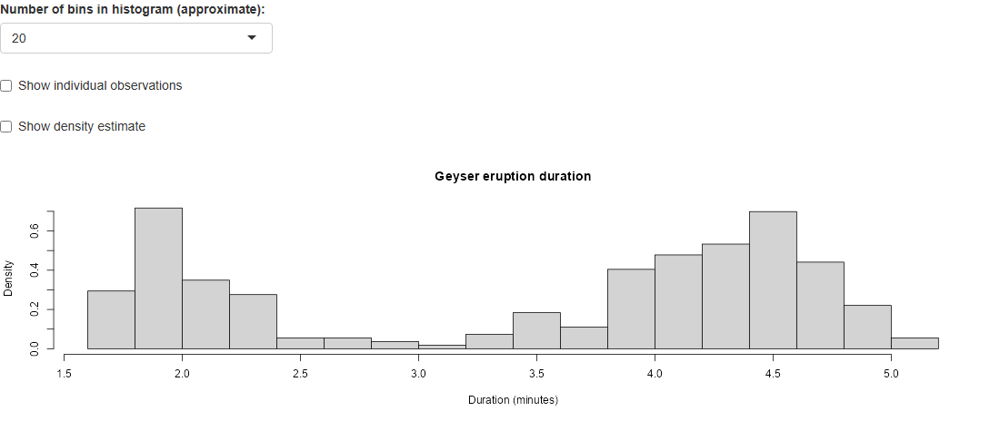
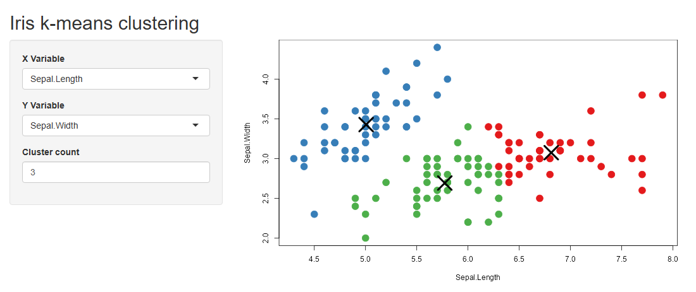
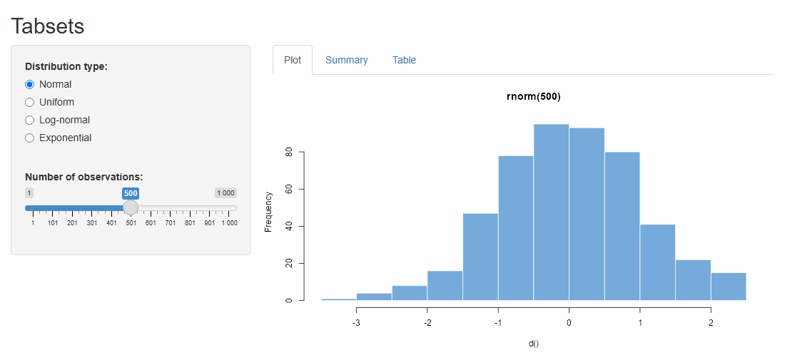
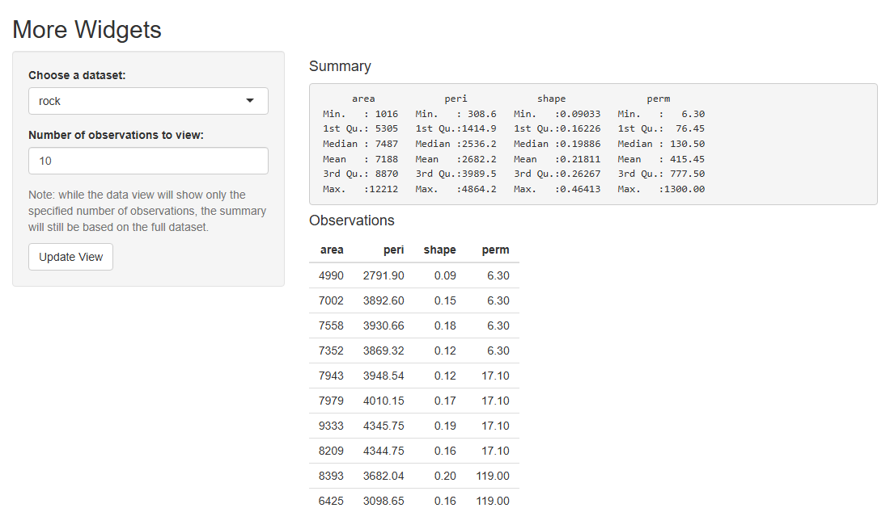
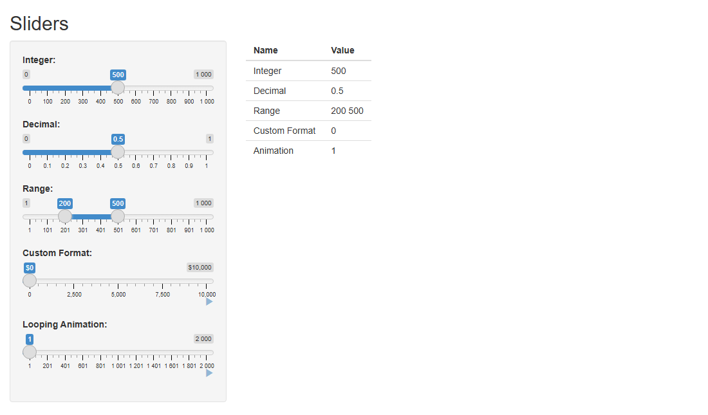
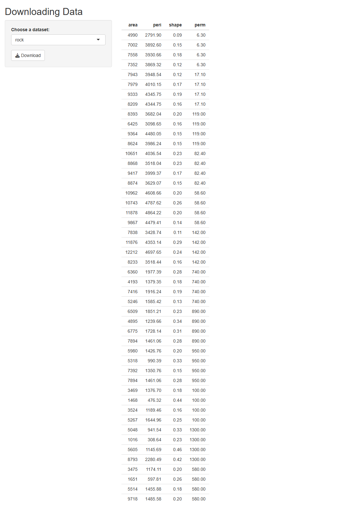
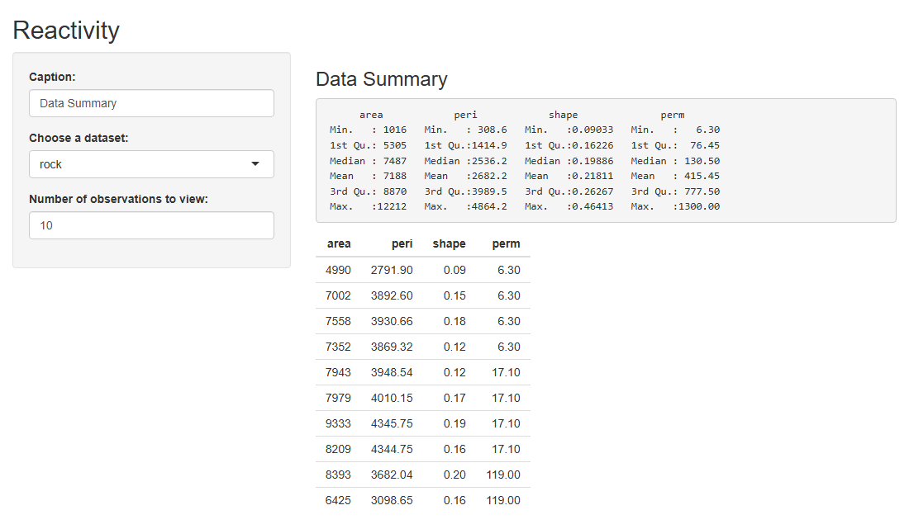
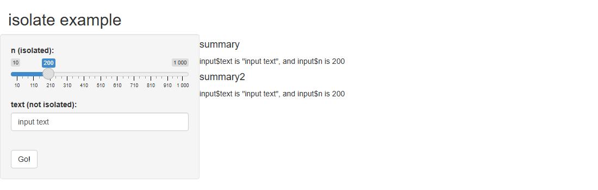
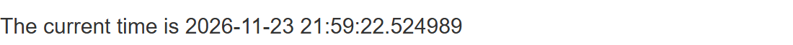
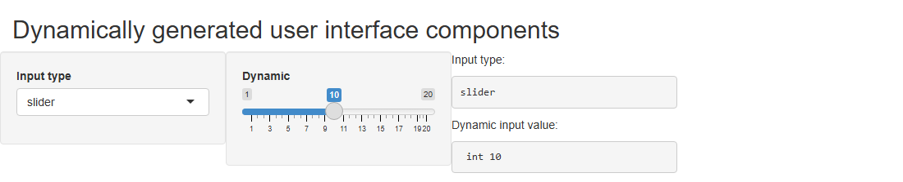

# Dashboards: gallery

The apps of the [Shiny gallery](https://shiny.posit.co/r/gallery/) are
written as R code (a user interface and a server function). Here they
are rebuilt from YAML configurations: the same inputs, outputs, layout
and server code, with the server code split into the services of the
outputs and a prescript for the reactive expressions. Small differences
of the html structure (for example rows around columns, or a
`titlePanel` instead of a `headerPanel`) are noted for each app.

The second part shows two large **showcase** dashboards combining most
features of rvis dashboards.

## Shiny gallery apps

### Faithful

Original:
[Faithful](https://shiny.posit.co/r/gallery/start-simple/faithful/)
(source in
[shiny-examples](https://github.com/rstudio/shiny-examples/tree/main/083-front-page)).

Run it: `runDashboard(rvisDashboardExample("faithful"))`

The original is a `bootstrapPage` and its check box labels are bold:
here a `fluidPage` with plain labels. The bandwidth slider is in a
`conditionalPanel`.



Screenshot of the Faithful dashboard

YAML configuration

``` yaml
# Shiny gallery: Faithful (shiny-examples 083-front-page)
# https://shiny.posit.co/r/gallery/start-simple/faithful/
name: Faithful
layout: page
items:
  page:
    type: fluidPage
    layout: [n_breaks, individual_obs, density, main_plot, bandwidth]

  n_breaks:
    type: selectInput
    title: "Number of bins in histogram (approximate):"
    choices: [10, 20, 35, 50]
    selected: 20

  individual_obs:
    type: checkboxInput
    title: Show individual observations
    value: false

  density:
    type: checkboxInput
    title: Show density estimate
    value: false

  main_plot:
    type: plotOutput
    height: 300px
    service: |
      hist(faithful$eruptions,
        probability = TRUE,
        breaks = as.numeric(input$n_breaks),
        xlab = "Duration (minutes)",
        main = "Geyser eruption duration")
      if (input$individual_obs) {
        rug(faithful$eruptions)
      }
      if (input$density) {
        dens <- density(faithful$eruptions, adjust = input$bw_adjust)
        lines(dens, col = "blue")
      }

  # Display this only if the density is shown
  bandwidth:
    type: conditionalPanel
    condition: input.density == true
    layout: [bw_adjust]

  bw_adjust:
    type: sliderInput
    title: "Bandwidth adjustment:"
    min: 0.2
    max: 2
    value: 1
    step: 0.2
```

### Kmeans example

Original: [Kmeans
example](https://shiny.posit.co/r/gallery/start-simple/kmeans-example/)
(source in
[shiny-examples](https://github.com/rstudio/shiny-examples/tree/main/050-kmeans-example)).

Run it: `runDashboard(rvisDashboardExample("kmeans"))`

The reactive expressions `selectedData()` and `clusters()` are defined
in the prescript. The original uses
[`pageWithSidebar()`](https://rdrr.io/pkg/shiny/man/pageWithSidebar.html)
with a `headerPanel`: here a `sidebarLayout` with a `titlePanel`.



Screenshot of the Kmeans example dashboard

YAML configuration

``` yaml
# Shiny gallery: Kmeans example (shiny-examples 050-kmeans-example)
# https://shiny.posit.co/r/gallery/start-simple/kmeans-example/
name: Iris k-means clustering
layout: page

# Reactive expressions used by the services are defined in the prescript, which runs at the start of each session
prescript: |
  # Combine the selected variables into a new data frame
  selectedData <- reactive({
    iris[, c(input$xcol, input$ycol)]
  })
  clusters <- reactive({
    kmeans(selectedData(), input$clusters)
  })

items:
  page:
    type: sidebarLayout
    title: Iris k-means clustering
    layout.side: [xcol, ycol, clusters]
    layout.main: [plot1]

  # k-means only works with numerical variables, so don't give the user the option to select a categorical variable
  xcol:
    type: selectInput
    title: X Variable
    choices: !expr setdiff(names(iris), "Species")

  ycol:
    type: selectInput
    title: Y Variable
    choices: !expr setdiff(names(iris), "Species")
    selected: Sepal.Width

  clusters:
    type: numericInput
    title: Cluster count
    value: 3
    min: 1
    max: 9

  plot1:
    type: plotOutput
    service: |
      palette(c("#E41A1C", "#377EB8", "#4DAF4A", "#984EA3",
        "#FF7F00", "#FFFF33", "#A65628", "#F781BF", "#999999"))
      par(mar = c(5.1, 4.1, 0, 1))
      plot(selectedData(),
           col = clusters()$cluster,
           pch = 20, cex = 3)
      points(clusters()$centers, pch = 4, cex = 4, lwd = 4)
```

### Telephones by region

Original: [Telephones by
region](https://shiny.posit.co/r/gallery/start-simple/telephones-by-region/)
(source in
[shiny-examples](https://github.com/rstudio/shiny-examples/tree/main/064-telephones-by-region)).

Run it: `runDashboard(rvisDashboardExample("telephones"))`

The horizontal rule and the help text are static html items.


Screenshot of the Telephones by region dashboard

YAML configuration

``` yaml
# Shiny gallery: Telephones by region (shiny-examples 064-telephones-by-region)
# https://shiny.posit.co/r/gallery/start-simple/telephones-by-region/
name: Telephones by region
layout: page
items:
  page:
    type: sidebarLayout
    title: Telephones by region
    layout.side: [region, rule, help]
    layout.main: [phonePlot]

  region:
    type: selectInput
    title: "Region:"
    choices: !expr colnames(WorldPhones)

  rule:
    type: static
    html: <hr/>

  help:
    type: static
    html: <span class="help-block">Data from AT&amp;T (1961) The World's Telephones.</span>

  phonePlot:
    type: plotOutput
    service: |
      barplot(WorldPhones[, input$region] * 1000,
              main = input$region,
              ylab = "Number of Telephones",
              xlab = "Year")
```

### Tabsets

Original:
[Tabsets](https://shiny.posit.co/r/gallery/application-layout/tabsets/)
(source in
[shiny-examples](https://github.com/rstudio/shiny-examples/tree/main/006-tabsets)).

Run it: `runDashboard(rvisDashboardExample("tabsets"))`



Screenshot of the Tabsets dashboard

YAML configuration

``` yaml
# Shiny gallery: Tabsets (shiny-examples 006-tabsets)
# https://shiny.posit.co/r/gallery/application-layout/tabsets/
name: Tabsets
layout: page

prescript: |
  # Reactive expression to generate the requested distribution
  d <- reactive({
    dist <- switch(input$dist,
                   norm = rnorm,
                   unif = runif,
                   lnorm = rlnorm,
                   exp = rexp,
                   rnorm)
    dist(input$n)
  })

items:
  page:
    type: sidebarLayout
    title: Tabsets
    layout.side: [dist, space, n]
    layout.main: [tabs]

  dist:
    type: radioButtons
    title: "Distribution type:"
    choices:
      Normal: norm
      Uniform: unif
      Log-normal: lnorm
      Exponential: exp

  space:
    type: static
    html: <br/>

  n:
    type: sliderInput
    title: "Number of observations:"
    value: 500
    min: 1
    max: 1000

  tabs:
    type: tabsetPanel
    shape: tabs
    layout: [plot_tab, summary_tab, table_tab]

  plot_tab:    {type: tabPanel, title: Plot, layout: [plot]}
  summary_tab: {type: tabPanel, title: Summary, layout: [summary]}
  table_tab:   {type: tabPanel, title: Table, layout: [table]}

  plot:
    type: plotOutput
    service: |
      dist <- input$dist
      n <- input$n
      hist(d(),
           main = paste("r", dist, "(", n, ")", sep = ""),
           col = "#75AADB", border = "white")

  summary:
    type: verbatimTextOutput
    service: summary(d())

  table:
    type: tableOutput
    service: d()
```

### Navbar example

Original: [Navbar
example](https://shiny.posit.co/r/gallery/application-layout/navbar-example/)
(source in
[shiny-examples](https://github.com/rstudio/shiny-examples/tree/main/052-navbar-example)).

Run it: `runDashboard(rvisDashboardExample("navbar-example"))`

The text of the About tab is html in the configuration, instead of a
markdown file read by
[`includeMarkdown()`](https://rstudio.github.io/htmltools/reference/include.html).


Screenshot of the Navbar example dashboard

YAML configuration

``` yaml
# Shiny gallery: Navbar example (shiny-examples 052-navbar-example)
# https://shiny.posit.co/r/gallery/application-layout/navbar-example/
name: Navbar!
layout: nav
items:
  nav:
    type: navbarPage
    title: Navbar!
    layout: [plot_tab, summary_tab, more]

  plot_tab:
    type: tabPanel
    title: Plot
    layout: [plot_page]

  plot_page:
    type: sidebarLayout
    layout.side: [plotType]
    layout.main: [plot]

  plotType:
    type: radioButtons
    title: Plot type
    choices: {Scatter: p, Line: l}

  plot:
    type: plotOutput
    service: plot(cars, type = input$plotType)

  summary_tab:
    type: tabPanel
    title: Summary
    layout: [summary]

  summary:
    type: verbatimTextOutput
    service: summary(cars)

  more:
    type: navbarMenu
    title: More
    layout: [table_tab, about_tab]

  table_tab:
    type: tabPanel
    title: Table
    layout: [table]

  table:
    type: dataTableOutput
    service: DT::datatable(cars)

  about_tab:
    type: tabPanel
    title: About
    # one row with two columns of widths 6 and 3
    layout:
      - - {weight: 6, items: about}
        - {weight: 3, items: photo}

  about:
    type: static
    html: |
      <h3>Speed and Stopping Distances of Cars</h3>
      <p>The data give the speed of cars and the distances taken to stop. Note that the data were recorded in the 1920s.</p>
      <ul>
        <li><strong>Speed</strong> - speed (mph)</li>
        <li><strong>Dist</strong> - stopping distance (ft)</li>
      </ul>

  photo:
    type: static
    html: |
      
      <small>Source: Photographed at the Bay State Antique Automobile Club's July 10, 2005 show at the Endicott Estate in Dedham, MA by
      <a href="http://commons.wikimedia.org/wiki/User:Sfoskett">User:Sfoskett</a></small>
```

### Plot plus three columns

Original: [Plot plus three
columns](https://shiny.posit.co/r/gallery/application-layout/plot-plus-three-columns/)
(source in
[shiny-examples](https://github.com/rstudio/shiny-examples/tree/main/057-plot-plus-three-columns)).

Run it: `runDashboard(rvisDashboardExample("diamonds"))`

Needs package ggplot2. The inputs of each column are in a row inside the
column.


Screenshot of the Plot plus three columns dashboard

YAML configuration

``` yaml
# Shiny gallery: Plot plus three columns (shiny-examples 057-plot-plus-three-columns)
# https://shiny.posit.co/r/gallery/application-layout/plot-plus-three-columns/
# Needs package ggplot2.
name: Diamonds Explorer
layout: page

prescript: |
  library(ggplot2)
  dataset <- reactive({
    diamonds[sample(nrow(diamonds), input$sampleSize), ]
  })

items:
  page:
    type: fluidPage
    wintitle: Diamonds Explorer
    layout:
      - [plot]
      - [rule]
      # a row of three columns
      - - {weight: 3, items: [heading, sampleSize, space, jitter, smooth]}
        - {weight: 4, offset: 1, items: [x, y, color]}
        - {weight: 4, items: [facet_row, facet_col]}

  plot:
    type: plotOutput
    service: |
      p <- ggplot(dataset(), aes_string(x = input$x, y = input$y)) + geom_point()
      if (input$color != 'None')
        p <- p + aes_string(color = input$color)
      facets <- paste(input$facet_row, '~', input$facet_col)
      if (facets != '. ~ .')
        p <- p + facet_grid(facets)
      if (input$jitter)
        p <- p + geom_jitter()
      if (input$smooth)
        p <- p + geom_smooth()
      print(p)

  rule:    {type: static, html: <hr/>}
  heading: {type: static, html: <h4>Diamonds Explorer</h4>}
  space:   {type: static, html: <br/>}

  sampleSize:
    type: sliderInput
    title: Sample Size
    min: 1
    max: !expr nrow(ggplot2::diamonds)
    value: 1000
    step: 500
    round: 0

  jitter: {type: checkboxInput, title: Jitter}
  smooth: {type: checkboxInput, title: Smooth}

  x:
    type: selectInput
    title: X
    choices: !expr names(ggplot2::diamonds)

  y:
    type: selectInput
    title: Y
    choices: !expr names(ggplot2::diamonds)
    selected: cut

  color:
    type: selectInput
    title: Color
    choices: !expr c('None', names(ggplot2::diamonds))

  facet_row:
    type: selectInput
    title: Facet Row
    choices: !expr c(None = '.', names(ggplot2::diamonds)[sapply(ggplot2::diamonds, is.factor)])

  facet_col:
    type: selectInput
    title: Facet Column
    choices: !expr c(None = '.', names(ggplot2::diamonds)[sapply(ggplot2::diamonds, is.factor)])
```

### Widgets

Original: [Widgets](https://shiny.posit.co/r/gallery/widgets/widgets/)
(source in
[shiny-examples](https://github.com/rstudio/shiny-examples/tree/main/007-widgets)).

Run it: `runDashboard(rvisDashboardExample("more-widgets"))`

The event reactive `datasetInput()` (updated when the button is clicked)
is defined in the prescript.



Screenshot of the Widgets dashboard

YAML configuration

``` yaml
# Shiny gallery: Widgets (shiny-examples 007-widgets)
# https://shiny.posit.co/r/gallery/widgets/widgets/
name: More Widgets
layout: page

prescript: |
  # The dataset is only updated when the user clicks the action button
  datasetInput <- eventReactive(input$update, {
    switch(input$dataset,
           "rock" = rock,
           "pressure" = pressure,
           "cars" = cars)
  }, ignoreNULL = FALSE)

items:
  page:
    type: sidebarLayout
    title: More Widgets
    layout.side: [dataset, obs, help, update]
    layout.main: [summary_title, summary, view_title, view]

  dataset:
    type: selectInput
    title: "Choose a dataset:"
    choices: [rock, pressure, cars]

  obs:
    type: numericInput
    title: "Number of observations to view:"
    value: 10

  help:
    type: static
    html: >
      <span class="help-block">Note: while the data view will show only the specified number of observations,
      the summary will still be based on the full dataset.</span>

  update:
    type: actionButton
    title: Update View

  summary_title: {type: static, html: <h4>Summary</h4>}
  view_title:    {type: static, html: <h4>Observations</h4>}

  summary:
    type: verbatimTextOutput
    service: |
      dataset <- datasetInput()
      summary(dataset)

  # isolate() is used because the table should only update when the user clicks the action button
  view:
    type: tableOutput
    service: head(datasetInput(), n = isolate(input$obs))
```

### Sliders

Original: [Sliders](https://shiny.posit.co/r/gallery/widgets/sliders/)
(source in
[shiny-examples](https://github.com/rstudio/shiny-examples/tree/main/005-sliders)).

Run it: `runDashboard(rvisDashboardExample("sliders"))`

The looping animation is given as an R expression:
`animate: !expr shiny::animationOptions(interval = 300, loop = TRUE)`.



Screenshot of the Sliders dashboard

YAML configuration

``` yaml
# Shiny gallery: Sliders (shiny-examples 005-sliders)
# https://shiny.posit.co/r/gallery/widgets/sliders/
name: Sliders
layout: page

prescript: |
  sliderValues <- reactive({
    data.frame(
      Name = c("Integer", "Decimal", "Range", "Custom Format", "Animation"),
      Value = as.character(c(input$integer,
                             input$decimal,
                             paste(input$range, collapse = " "),
                             input$format,
                             input$animation)),
      stringsAsFactors = FALSE)
  })

items:
  page:
    type: sidebarLayout
    title: Sliders
    layout.side: [integer, decimal, range, format, animation]
    layout.main: [values]

  integer:
    type: sliderInput
    title: "Integer:"
    min: 0
    max: 1000
    value: 500

  decimal:
    type: sliderInput
    title: "Decimal:"
    min: 0
    max: 1
    value: 0.5
    step: 0.1

  range:
    type: sliderInput
    title: "Range:"
    min: 1
    max: 1000
    value: [200, 500]

  format:
    type: sliderInput
    title: "Custom Format:"
    min: 0
    max: 10000
    value: 0
    step: 2500
    pre: $
    sep: ","
    animate: true

  animation:
    type: sliderInput
    title: "Looping Animation:"
    min: 1
    max: 2000
    value: 1
    step: 10
    animate: !expr shiny::animationOptions(interval = 300, loop = TRUE)

  values:
    type: tableOutput
    service: sliderValues()
```

### Date and date range

Original: [Date and date
range](https://shiny.posit.co/r/gallery/widgets/date-and-date-range/)
(source in
[shiny-examples](https://github.com/rstudio/shiny-examples/tree/main/037-date-and-date-range)).

Run it: `runDashboard(rvisDashboardExample("dates"))`

Dates relative to today are R expressions (`!expr Sys.Date() - 5`). The
verbatim outputs use [`cat()`](https://rdrr.io/r/base/cat.html): their
render function is
[`renderPrint()`](https://rdrr.io/pkg/shiny/man/renderPrint.html) (the
original uses
[`renderText()`](https://rdrr.io/pkg/shiny/man/renderPrint.html)).


Screenshot of the Date and date range dashboard

YAML configuration

``` yaml
# Shiny gallery: Date and date range (shiny-examples 037-date-and-date-range)
# https://shiny.posit.co/r/gallery/widgets/date-and-date-range/
name: Dates and date ranges
layout: page
items:
  page:
    type: fluidPage
    title: Dates and date ranges
    layout:
      - - {weight: 4, items: inputs}
        - {weight: 6, items: [dateText, dateText2, dateRangeText, dateRangeText2]}

  inputs:
    type: wellPanel
    layout: [date, date2, dateRange, dateRange2]

  date:
    type: dateInput
    title: "Date input: yyyy-mm-dd"
    value: !expr Sys.Date()

  date2:
    type: dateInput
    title: "Date input 2: string for starting value, dd/mm/yy format, locale ja, range limited, week starts on day 1 (Monday)"
    value: !expr as.character(Sys.Date())
    min: !expr Sys.Date() - 5
    max: !expr Sys.Date() + 5
    format: dd/mm/yy
    startview: year
    language: zh-TW
    weekstart: 1

  dateRange:
    type: dateRangeInput
    title: "Date range input: yyyy-mm-dd"
    start: !expr Sys.Date() - 2
    end: !expr Sys.Date() + 2

  dateRange2:
    type: dateRangeInput
    title: 'Date range input 2: range is limited, dd/mm/yy, language: fr, week starts on day 1 (Monday), separator is "-", start view is year'
    start: !expr Sys.Date() - 3
    end: !expr Sys.Date() + 3
    min: !expr Sys.Date() - 10
    max: !expr Sys.Date() + 10
    separator: " - "
    format: dd/mm/yy
    startview: year
    language: fr
    weekstart: 1

  # verbatimTextOutput services are printed: cat() prints the text without quotes
  dateText:
    type: verbatimTextOutput
    service: cat(paste("input$date is", as.character(input$date)))

  dateText2:
    type: verbatimTextOutput
    service: cat(paste("input$date2 is", as.character(input$date2)))

  dateRangeText:
    type: verbatimTextOutput
    service: cat(paste("input$dateRange is", paste(as.character(input$dateRange), collapse = " to ")))

  dateRangeText2:
    type: verbatimTextOutput
    service: cat(paste("input$dateRange2 is", paste(as.character(input$dateRange2), collapse = " to ")))
```

### File download

Original: [File
download](https://shiny.posit.co/r/gallery/widgets/file-download/)
(source in
[shiny-examples](https://github.com/rstudio/shiny-examples/tree/main/010-download)).

Run it: `runDashboard(rvisDashboardExample("download"))`

The `filename` of a download button is R code giving the file name, its
service writes the file.



Screenshot of the File download dashboard

YAML configuration

``` yaml
# Shiny gallery: File Download (shiny-examples 010-download)
# https://shiny.posit.co/r/gallery/widgets/file-download/
name: Downloading Data
layout: page

prescript: |
  datasetInput <- reactive({
    switch(input$dataset,
           "rock" = rock,
           "pressure" = pressure,
           "cars" = cars)
  })

items:
  page:
    type: sidebarLayout
    title: Downloading Data
    layout.side: [dataset, downloadData]
    layout.main: [table]

  dataset:
    type: selectInput
    title: "Choose a dataset:"
    choices: [rock, pressure, cars]

  # filename: R code returning the file name; service: R code writing the content to 'file'
  downloadData:
    type: downloadButton
    title: Download
    filename: paste(input$dataset, ".csv", sep = "")
    service: write.csv(datasetInput(), file, row.names = FALSE)

  table:
    type: tableOutput
    service: datasetInput()
```

### Basic DataTable

Original: [Basic
DataTable](https://shiny.posit.co/r/gallery/widgets/basic-datatable/)
(source in
[shiny-examples](https://github.com/rstudio/shiny-examples/tree/main/030-basic-datatable)).

Run it: `runDashboard(rvisDashboardExample("basic-datatable"))`

Needs packages ggplot2 (data set `mpg`) and DT.


Screenshot of the Basic DataTable dashboard

YAML configuration

``` yaml
# Shiny gallery: Basic DataTable (shiny-examples 030-basic-datatable)
# https://shiny.posit.co/r/gallery/widgets/basic-datatable/
# Needs packages ggplot2 (dataset mpg) and DT.
name: Basic DataTable
layout: page
items:
  page:
    type: fluidPage
    title: Basic DataTable
    layout:
      # a row of three columns (each column gets 12/3 = 4 grid units), then the table
      - - [man]
        - [trans]
        - [cyl]
      - [table]

  man:
    type: selectInput
    title: "Manufacturer:"
    choices: !expr c("All", unique(as.character(ggplot2::mpg$manufacturer)))

  trans:
    type: selectInput
    title: "Transmission:"
    choices: !expr c("All", unique(as.character(ggplot2::mpg$trans)))

  cyl:
    type: selectInput
    title: "Cylinders:"
    choices: !expr c("All", unique(as.character(ggplot2::mpg$cyl)))

  table:
    type: dataTableOutput
    service: |
      DT::datatable({
        data <- ggplot2::mpg
        if (input$man != "All") {
          data <- data[data$manufacturer == input$man,]
        }
        if (input$cyl != "All") {
          data <- data[data$cyl == input$cyl,]
        }
        if (input$trans != "All") {
          data <- data[data$trans == input$trans,]
        }
        data
      })
```

### Reactivity

Original:
[Reactivity](https://shiny.posit.co/r/gallery/reactive-programming/reactivity/)
(source in
[shiny-examples](https://github.com/rstudio/shiny-examples/tree/main/003-reactivity)).

Run it: `runDashboard(rvisDashboardExample("reactivity"))`

The caption is a text output with `tag: h3`.



Screenshot of the Reactivity dashboard

YAML configuration

``` yaml
# Shiny gallery: Reactivity (shiny-examples 003-reactivity)
# https://shiny.posit.co/r/gallery/reactive-programming/reactivity/
name: Reactivity
layout: page

prescript: |
  datasetInput <- reactive({
    switch(input$dataset,
           "rock" = rock,
           "pressure" = pressure,
           "cars" = cars)
  })

items:
  page:
    type: sidebarLayout
    title: Reactivity
    layout.side: [caption, dataset, obs]
    layout.main: [caption_text, summary, view]

  caption:
    type: textInput
    title: "Caption:"
    value: Data Summary

  dataset:
    type: selectInput
    title: "Choose a dataset:"
    choices: [rock, pressure, cars]

  obs:
    type: numericInput
    title: "Number of observations to view:"
    value: 10

  # a text output shown as a level 3 heading
  caption_text:
    type: textOutput
    tag: h3
    service: input$caption

  summary:
    type: verbatimTextOutput
    service: |
      dataset <- datasetInput()
      summary(dataset)

  view:
    type: tableOutput
    service: head(datasetInput(), n = input$obs)
```

### isolate demo

Original: [isolate
demo](https://shiny.posit.co/r/gallery/reactive-programming/isolate-demo/)
(source in
[shiny-examples](https://github.com/rstudio/shiny-examples/tree/main/049-isolate-demo)).

Run it: `runDashboard(rvisDashboardExample("isolate"))`



Screenshot of the isolate demo dashboard

YAML configuration

``` yaml
# Shiny gallery: isolate demo (shiny-examples 049-isolate-demo)
# https://shiny.posit.co/r/gallery/reactive-programming/isolate-demo/
name: isolate example
layout: page
items:
  page:
    type: fluidPage
    title: isolate example
    layout:
      - - {weight: 4, items: controls}
        - {weight: 8, items: [summary_title, summary, summary2_title, summary2]}

  controls:
    type: wellPanel
    layout: [n, text, space, goButton]

  n:
    type: sliderInput
    title: "n (isolated):"
    min: 10
    max: 1000
    value: 200
    step: 10

  text:
    type: textInput
    title: "text (not isolated):"
    value: input text

  space: {type: static, html: <br/>}

  goButton:
    type: actionButton
    title: Go!

  summary_title:  {type: static, html: <h4>summary</h4>}
  summary2_title: {type: static, html: <h4>summary2</h4>}

  summary:
    type: textOutput
    service: |
      input$goButton
      paste0('input$text is "', input$text, '", and input$n is ', isolate(input$n))

  summary2:
    type: textOutput
    service: |
      input$goButton
      str <- paste0('input$text is "', input$text, '"')
      isolate({
        str <- paste0(str, ', and input$n is ')
        paste0(str, isolate(input$n))
      })
```

### Timer

Original:
[Timer](https://shiny.posit.co/r/gallery/reactive-programming/timer/)
(source in
[shiny-examples](https://github.com/rstudio/shiny-examples/tree/main/011-timer)).

Run it: `runDashboard(rvisDashboardExample("timer"))`

`invalidateLater(1000, session)` in the service updates the text every
second.



Screenshot of the Timer dashboard

YAML configuration

``` yaml
# Shiny gallery: Timer (shiny-examples 011-timer)
# https://shiny.posit.co/r/gallery/reactive-programming/timer/
name: Timer
layout: page
items:
  page:
    type: fluidPage
    layout: [currentTime]

  currentTime:
    type: textOutput
    tag: h2
    service: |
      invalidateLater(1000, session)
      paste("The current time is", Sys.time())
```

### Dynamic UI

Original: [Dynamic
UI](https://shiny.posit.co/r/gallery/dynamic-user-interface/dynamic-ui/)
(source in
[shiny-examples](https://github.com/rstudio/shiny-examples/tree/main/041-dynamic-ui)).

Run it: `runDashboard(rvisDashboardExample("dynamic-ui"))`

The dynamic input is a `dynamicInput` item: its service returns the
input to show.



Screenshot of the Dynamic UI dashboard

YAML configuration

``` yaml
# Shiny gallery: Dynamic UI (shiny-examples 041-dynamic-ui)
# https://shiny.posit.co/r/gallery/dynamic-user-interface/dynamic-ui/
name: Dynamically generated user interface components
layout: page
items:
  page:
    type: fluidPage
    title: Dynamically generated user interface components
    layout:
      - - {weight: 3, items: type_panel}
        - {weight: 3, items: ui_panel}
        - {weight: 3, items: [type_label, input_type_text, value_label, dynamic_value]}

  type_panel:
    type: wellPanel
    layout: [input_type]

  ui_panel:
    type: wellPanel
    layout: [ui]

  input_type:
    type: selectInput
    title: Input type
    choices: [slider, text, numeric, checkbox, checkboxGroup, radioButtons, selectInput, selectInput (multi), date, daterange]

  # a dynamicInput item is rendered by renderUI(): its service returns the input to show
  ui:
    type: dynamicInput
    service: |
      if (is.null(input$input_type))
        return()
      switch(input$input_type,
        "slider" = sliderInput("dynamic", "Dynamic", min = 1, max = 20, value = 10),
        "text" = textInput("dynamic", "Dynamic", value = "starting value"),
        "numeric" = numericInput("dynamic", "Dynamic", value = 12),
        "checkbox" = checkboxInput("dynamic", "Dynamic", value = TRUE),
        "checkboxGroup" = checkboxGroupInput("dynamic", "Dynamic",
          choices = c("Option 1" = "option1", "Option 2" = "option2"), selected = "option2"),
        "radioButtons" = radioButtons("dynamic", "Dynamic",
          choices = c("Option 1" = "option1", "Option 2" = "option2"), selected = "option2"),
        "selectInput" = selectInput("dynamic", "Dynamic",
          choices = c("Option 1" = "option1", "Option 2" = "option2"), selected = "option2"),
        "selectInput (multi)" = selectInput("dynamic", "Dynamic",
          choices = c("Option 1" = "option1", "Option 2" = "option2"),
          selected = c("option1", "option2"), multiple = TRUE),
        "date" = dateInput("dynamic", "Dynamic"),
        "daterange" = dateRangeInput("dynamic", "Dynamic")
      )

  type_label:  {type: static, html: "<p>Input type:</p>"}
  value_label: {type: static, html: "<p>Dynamic input value:</p>"}

  input_type_text:
    type: verbatimTextOutput
    service: cat(input$input_type)

  dynamic_value:
    type: verbatimTextOutput
    service: str(input$dynamic)
```

### conditionalPanel demo

Original: [conditionalPanel
demo](https://shiny.posit.co/r/gallery/dynamic-user-interface/conditionalpanel-demo/)
(source in
[shiny-examples](https://github.com/rstudio/shiny-examples/tree/main/033-conditionalpanel-demo)).

Run it: `runDashboard(rvisDashboardExample("conditional-panel"))`


Screenshot of the conditionalPanel demo dashboard

YAML configuration

``` yaml
# Shiny gallery: conditionalPanel demo (shiny-examples 033-conditionalpanel-demo)
# https://shiny.posit.co/r/gallery/dynamic-user-interface/conditionalpanel-demo/
name: Conditional panels
layout: page
items:
  page:
    type: fluidPage
    title: Conditional panels
    layout:
      - - {weight: 4, items: controls}
        - {weight: 5, items: [note, plot_panel]}

  controls:
    type: wellPanel
    layout: [n]

  n:
    type: sliderInput
    title: "Number of points:"
    min: 10
    max: 200
    value: 50
    step: 10

  note:
    type: static
    html: The plot below will be not displayed when the slider value is less than 50.

  # the condition is a javascript expression of the inputs
  plot_panel:
    type: conditionalPanel
    condition: input.n >= 50
    layout: [scatterPlot]

  scatterPlot:
    type: plotOutput
    height: 300px
    service: |
      x <- rnorm(input$n)
      y <- rnorm(input$n)
      plot(x, y)
```

### Modal dialogs

Original: [Modal
dialogs](https://shiny.posit.co/r/gallery/advanced-shiny/modal-dialogs/)
(source in
[shiny-examples](https://github.com/rstudio/shiny-examples/tree/main/114-modal-dialog)).

Run it: `runDashboard(rvisDashboardExample("modal-dialog"))`

The service of the button shows the modal dialog.


Screenshot of the Modal dialogs dashboard

YAML configuration

``` yaml
# Shiny gallery: Modal dialogs (shiny-examples 114-modal-dialog)
# https://shiny.posit.co/r/gallery/advanced-shiny/modal-dialogs/
name: Modal dialog
layout: page
items:
  page:
    type: fluidPage
    layout: [show]

  # the service of an input runs when the input changes (here: when the button is clicked)
  show:
    type: actionButton
    title: Show modal dialog
    service: |
      showModal(modalDialog(
        title = "Important message",
        "This is an important message!",
        easyClose = TRUE
      ))
```

### Progress bar example

Original: [Progress bar
example](https://shiny.posit.co/r/gallery/advanced-shiny/progress-bar-example/)
(source in
[shiny-examples](https://github.com/rstudio/shiny-examples/tree/main/085-progress)).

Run it: `runDashboard(rvisDashboardExample("progress"))`

The function `compute_data()` is defined in the prescript.


Screenshot of the Progress bar example dashboard

YAML configuration

``` yaml
# Shiny gallery: Progress bar example (shiny-examples 085-progress)
# https://shiny.posit.co/r/gallery/advanced-shiny/progress-bar-example/
name: Progress bar example
layout: page

# a function used by the table service, defined at the start of each session
prescript: |
  compute_data <- function(updateProgress = NULL) {
    dat <- data.frame(x = numeric(0), y = numeric(0))
    for (i in 1:10) {
      Sys.sleep(0.25)
      new_row <- data.frame(x = rnorm(1), y = rnorm(1))
      if (is.function(updateProgress)) {
        text <- paste0("x:", round(new_row$x, 2), " y:", round(new_row$y, 2))
        updateProgress(detail = text)
      }
      dat <- rbind(dat, new_row)
    }
    dat
  }

items:
  page:
    type: fluidPage
    layout: [plot, table, style, goPlot, goTable]

  plot:
    type: plotOutput
    width: 300px
    height: 300px
    service: |
      input$goPlot # Re-run when button is clicked
      style <- isolate(input$style)
      withProgress(message = 'Creating plot', style = style, value = 0.1, {
        Sys.sleep(0.25)
        dat <- data.frame(x = numeric(0), y = numeric(0))
        withProgress(message = 'Generating data', style = style, detail = "part 0", value = 0, {
          for (i in 1:10) {
            dat <- rbind(dat, data.frame(x = rnorm(1), y = rnorm(1)))
            incProgress(0.1, detail = paste("part", i))
            Sys.sleep(0.1)
          }
        })
        incProgress(0.5)
        withProgress(message = 'And this also', detail = "This other thing", style = style, value = NULL, {
          Sys.sleep(0.75)
        })
        setProgress(1)
      })
      plot(cars$speed, cars$dist)

  table:
    type: tableOutput
    service: |
      input$goTable
      style <- isolate(input$style)
      progress <- shiny::Progress$new(style = style)
      progress$set(message = "Computing data", value = 0)
      on.exit(progress$close())
      updateProgress <- function(value = NULL, detail = NULL) {
        if (is.null(value)) {
          value <- progress$getValue()
          value <- value + (progress$getMax() - value) / 5
        }
        progress$set(value = value, detail = detail)
      }
      compute_data(updateProgress)

  style:
    type: radioButtons
    title: Progress bar style
    choices: [notification, old]

  goPlot:  {type: actionButton, title: Go plot}
  goTable: {type: actionButton, title: Go table}
```

### Plot interaction - basic

Original: [Plot interaction -
basic](https://shiny.posit.co/r/gallery/interactive-plots/plot-interaction-basic/)
(source in
[shiny-examples](https://github.com/rstudio/shiny-examples/tree/main/093-plot-interaction-basic)).

Run it: `runDashboard(rvisDashboardExample("plot-interaction"))`

Needs package ggplot2. The plot output gives the ids of the click,
double-click, hover and brush inputs; the css of the original page
header is a static `style` item.


Screenshot of the Plot interaction - basic dashboard

YAML configuration

``` yaml
# Shiny gallery: Plot interaction - basic (shiny-examples 093-plot-interaction-basic)
# https://shiny.posit.co/r/gallery/interactive-plots/plot-interaction-basic/
# Needs package ggplot2.
name: Plot interaction - basic
layout: page
prescript: library(ggplot2)
items:
  page:
    type: fluidPage
    layout:
      - [style]
      # a row of two columns of width 4
      - - {weight: 4, items: controls}
        - {weight: 4, items: plot1}
      # a row of four columns: each column gets 12/4 = 3 grid units
      - - [click_info]
        - [dblclick_info]
        - [hover_info]
        - [brush_info]

  style:
    type: static
    html: |
      <style>
        pre, table.table {
          font-size: smaller;
        }
      </style>

  controls:
    type: wellPanel
    layout: [plot_type]

  plot_type:
    type: radioButtons
    title: Plot type
    choices: [base, ggplot2]

  # click, dblclick, hover and brush give the ids of the inputs reporting mouse events on the plot
  plot1:
    type: plotOutput
    height: 350px
    click: plot_click
    dblclick: plot_dblclick
    hover: plot_hover
    brush: plot_brush
    service: |
      if (input$plot_type == "base") {
        plot(mtcars$wt, mtcars$mpg)
      } else if (input$plot_type == "ggplot2") {
        ggplot(mtcars, aes(wt, mpg)) + geom_point()
      }

  click_info:
    type: verbatimTextOutput
    service: |
      cat("input$plot_click:\n")
      str(input$plot_click)

  dblclick_info:
    type: verbatimTextOutput
    service: |
      cat("input$plot_dblclick:\n")
      str(input$plot_dblclick)

  hover_info:
    type: verbatimTextOutput
    service: |
      cat("input$plot_hover:\n")
      str(input$plot_hover)

  brush_info:
    type: verbatimTextOutput
    service: |
      cat("input$plot_brush:\n")
      str(input$plot_brush)
```

### Shiny theme selector

Original: [Shiny theme
selector](https://shiny.posit.co/r/gallery/application-layout/shiny-theme-selector/)
(source in
[shiny-examples](https://github.com/rstudio/shiny-examples/tree/main/117-shinythemes)).

Run it: `runDashboard(rvisDashboardExample("shinythemes"))`

Needs package shinythemes. The page is made of two items: the theme
selector (`!expr shinythemes::themeSelector()`) and the navbar page.


Screenshot of the Shiny theme selector dashboard

YAML configuration

``` yaml
# Shiny gallery: Shiny theme selector (shiny-examples 117-shinythemes)
# https://shiny.posit.co/r/gallery/application-layout/shiny-theme-selector/
# Needs package shinythemes.
name: shinythemes
# two items make the page: the theme selector and the navbar page
layout: [selector, nav]
items:
  selector:
    type: static
    object: !expr shinythemes::themeSelector()

  nav:
    type: navbarPage
    title: shinythemes
    layout: [navbar1, navbar2, navbar3]

  navbar1:
    type: tabPanel
    title: Navbar 1
    layout: [navbar1_page]

  navbar1_page:
    type: sidebarLayout
    layout.side: [file, txt, slider, default_label, action, primary_label, action2]
    layout.main: [tabs]

  file:   {type: fileInput, title: "File input:"}
  txt:    {type: textInput, title: "Text input:", value: general}
  slider: {type: sliderInput, title: "Slider input:", min: 1, max: 100, value: 30}
  default_label: {type: static, html: "<h5>Default actionButton:</h5>"}
  action: {type: actionButton, title: Search}
  primary_label: {type: static, html: "<h5>actionButton with CSS class:</h5>"}
  action2: {type: actionButton, title: Action button, class: btn-primary}

  tabs:
    type: tabsetPanel
    layout: [tab1, tab2, tab3]

  tab1:
    type: tabPanel
    title: Tab 1
    layout: [table_title, table, txt_title, txtout, headers]

  tab2: {type: tabPanel, title: Tab 2, layout: [blank]}
  tab3: {type: tabPanel, title: Tab 3, layout: [blank]}
  navbar2: {type: tabPanel, title: Navbar 2, layout: [blank]}
  navbar3: {type: tabPanel, title: Navbar 3, layout: [blank]}

  blank: {type: static, html: This panel is intentionally left blank}
  table_title: {type: static, html: <h4>Table</h4>}
  txt_title: {type: static, html: <h4>Verbatim text output</h4>}
  headers:
    type: static
    html: <h1>Header 1</h1><h2>Header 2</h2><h3>Header 3</h3><h4>Header 4</h4><h5>Header 5</h5>

  table:
    type: tableOutput
    service: head(cars, 4)

  txtout:
    type: verbatimTextOutput
    service: cat(paste(input$txt, input$slider, format(input$date), sep = ", "))
```

## Showcase dashboards

### US states explorer

Run it: `runDashboard(rvisDashboardExample("us-states"))`

A multi-page shinydashboard about the 50 US states (R data sets
`state.x77`, `state.region` and `state.center`): a sidebar menu with six
pages and two filters applying to all pages, value boxes, rvis charts
made by
[`rvisPlot()`](https://genpack.github.io/rvis/reference/rvisPlot.md)
(highcharter bar and pie charts, a plotly scatter chart), a leaflet map,
a table with download button, a help window (`bsModal`), tooltips, a
popover and a guided tour. Needs packages shinydashboard, shinyBS,
highcharter, plotly, leaflet, DT and rintrojs.


Screenshot of the US states explorer dashboard

YAML configuration

``` yaml
# A multi-page shinydashboard about the 50 US states (data sets state.x77, state.region, state.center).
# It shows: sidebar menu and pages, filters in the sidebar, value boxes, rvis charts (highcharter, plotly),
# a leaflet map, tables with download, a modal help window, tooltips, popovers and a guided tour.
# Needs packages shinydashboard, shinyBS, highcharter, plotly, leaflet, DT and rintrojs.
name: US states explorer
layout: dash

# data prepared at the start of each session
prescript: |
  states <- data.frame(
    state = state.name, abb = state.abb, region = as.character(state.region),
    lat = state.center$y, long = state.center$x, state.x77, check.names = FALSE, stringsAsFactors = FALSE)
  names(states) <- c("state", "abb", "region", "lat", "long", "Population", "Income", "Illiteracy",
                     "Life.Exp", "Murder", "HS.Grad", "Frost", "Area")
  measures <- c("Population (thousands)" = "Population", "Income per capita ($)" = "Income",
                "Illiteracy (%)" = "Illiteracy", "Life expectancy (years)" = "Life.Exp",
                "Murder rate (per 100,000)" = "Murder", "High-school graduates (%)" = "HS.Grad",
                "Days with frost" = "Frost", "Area (square miles)" = "Area")
  label <- function(m) names(measures)[measures == m]
  selected <- reactive({
    validate(need(length(input$regions) > 0, "Select at least one region."))
    states[states$region %in% input$regions, ]
  })

items:
  dash:
    type: dashboardPage
    title: US states explorer
    skin: blue
    header.title: US states
    header.title.font: trebuchet ms
    header.title.font.weight: bold
    layout.side: [menu, regions, measure, help, tour]
    layout.body: [pages, help_modal]

  # ---- sidebar ----
  menu:
    type: sidebarMenu
    layout: [m_overview, m_rankings, m_relations, m_map, m_data, m_about]
  m_overview:  {type: menuItem, title: Overview, tabName: overview, icon: gauge}
  m_rankings:  {type: menuItem, title: Rankings, tabName: rankings, icon: ranking-star}
  m_relations: {type: menuItem, title: Relationships, tabName: relations, icon: chart-line}
  m_map:       {type: menuItem, title: Map, tabName: map, icon: map-location-dot}
  m_data:      {type: menuItem, title: Data, tabName: data, icon: table}
  m_about:     {type: menuItem, title: About, tabName: about, icon: circle-info}

  regions:
    type: checkboxGroupInput
    title: Regions
    choices: !expr levels(state.region)
    selected: !expr levels(state.region)
    tooltip: The states of the selected regions are shown on all pages.
    tooltip.placement: right
    tutor.lesson: Choose the regions of the states shown on all pages.
    tutor.step: 2

  measure:
    type: selectInput
    title: Measure
    choices: {Population (thousands): Population, Income per capita ($): Income, Illiteracy (%): Illiteracy, Life expectancy (years): Life.Exp, Murder rate (per 100000): Murder, High-school graduates (%): HS.Grad, Days with frost: Frost, Area (square miles): Area}
    selected: Income
    tutor.lesson: The measure shown by the charts, the map and the rankings.
    tutor.step: 3

  help:
    type: actionButton
    title: Help
    icon: circle-question
    width: 85%

  tour:
    type: actionButton
    title: Guided tour
    icon: route
    width: 85%
    service: rintrojs::introjs(session)

  help_modal:
    type: bsModal
    title: How to use this dashboard
    trigger: help
    layout: [help_text]
  help_text:
    type: static
    html: |
      <p>Use the menu on the left to change pages. The <b>Regions</b> and <b>Measure</b> filters apply to all pages.</p>
      <ul>
        <li><b>Overview</b>: key figures and the measure by region.</li>
        <li><b>Rankings</b>: states with the highest and lowest values.</li>
        <li><b>Relationships</b>: compare two measures.</li>
        <li><b>Map</b>: the measure at the centre of each state.</li>
        <li><b>Data</b>: the table, which can be downloaded.</li>
      </ul>

  # ---- pages ----
  pages:
    type: tabItems
    layout: [overview, rankings, relations, map, data, about]

  overview:
    type: tabItem
    layout:
      - [n_states, population, income, life]
      - [by_region, share]
  rankings:
    type: tabItem
    layout:
      - [top_n]
      - [top, bottom]
  relations:
    type: tabItem
    layout:
      - [x_measure, y_measure]
      - [scatter, correlations]
  map:
    type: tabItem
    layout: [leaflet_map]
  data:
    type: tabItem
    layout: [table_box]
  about:
    type: tabItem
    layout: [about_text]

  # ---- overview ----
  n_states:
    type: valueBoxOutput
    weight: 3
    service: valueBox(nrow(selected()), "States", icon = icon("flag-usa"), color = "blue")
    tutor.lesson: Key figures of the selected states.
    tutor.step: 1
  population:
    type: valueBoxOutput
    weight: 3
    service: valueBox(format(round(sum(selected()$Population) / 1000, 1), nsmall = 1), "Population (millions, 1975)", icon = icon("users"), color = "aqua")
  income:
    type: valueBoxOutput
    weight: 3
    service: valueBox(paste0("$", format(round(mean(selected()$Income)), big.mark = ",")), "Mean income per capita (1974)", icon = icon("dollar-sign"), color = "green")
  life:
    type: valueBoxOutput
    weight: 3
    service: valueBox(round(mean(selected()$Life.Exp), 1), "Mean life expectancy (1969-71)", icon = icon("heart-pulse"), color = "red")

  by_region:
    type: highcharterOutput
    height: 320px
    service: |
      d <- aggregate(selected()[input$measure], list(region = selected()$region), mean)
      rvisPlot(type = "bar", plotter = "highcharter", obj = d, x = "region", y = input$measure)
    cloth: {type: box, title: Mean by region, status: primary, solidHeader: true, weight: 7}
    popover: Mean of the selected measure over the states of each region.
    popover.title: By region

  share:
    type: highcharterOutput
    height: 320px
    service: |
      d <- aggregate(Population ~ region, data = selected(), FUN = sum)
      rvisPlot(type = "pie", plotter = "highcharter", obj = d, label = "region", theta = "Population")
    cloth: {type: box, title: Population by region, status: primary, solidHeader: true, weight: 5}

  # ---- rankings ----
  top_n:
    type: sliderInput
    title: Number of states
    min: 3
    max: 15
    value: 8
    cloth: {type: box, weight: 4}

  top:
    type: highcharterOutput
    height: 360px
    service: |
      d <- head(selected()[order(-selected()[[input$measure]]), c("state", input$measure)], input$top_n)
      rvisPlot(type = "bar", plotter = "highcharter", obj = d, x = "state", y = input$measure)
    cloth: {type: box, title: Highest, status: success, weight: 6}

  bottom:
    type: highcharterOutput
    height: 360px
    service: |
      d <- head(selected()[order(selected()[[input$measure]]), c("state", input$measure)], input$top_n)
      rvisPlot(type = "bar", plotter = "highcharter", obj = d, x = "state", y = input$measure)
    cloth: {type: box, title: Lowest, status: danger, weight: 6}

  # ---- relationships ----
  x_measure:
    type: selectInput
    title: Horizontal axis
    choices: [Population, Income, Illiteracy, Life.Exp, Murder, HS.Grad, Frost, Area]
    selected: Illiteracy
    cloth: {type: box, weight: 6}
  y_measure:
    type: selectInput
    title: Vertical axis
    choices: [Population, Income, Illiteracy, Life.Exp, Murder, HS.Grad, Frost, Area]
    selected: Murder
    cloth: {type: box, weight: 6}

  scatter:
    type: plotlyOutput
    height: 400px
    service: rvisPlot(type = "scatter", plotter = "plotly", obj = selected(), x = input$x_measure, y = input$y_measure, color = "region", label = "state")
    cloth: {type: box, title: States, weight: 8}

  correlations:
    type: tableOutput
    digits: 2
    rownames: true
    service: cor(selected()[, c("Population", "Income", "Illiteracy", "Life.Exp", "Murder", "HS.Grad", "Frost")])[, c(input$x_measure, input$y_measure), drop = FALSE]
    cloth: {type: box, title: Correlations, weight: 4}

  # ---- map ----
  leaflet_map:
    type: leafletOutput
    height: 560px
    service: |
      d <- selected()
      v <- d[[input$measure]]
      pal <- leaflet::colorNumeric("viridis", v)
      leaflet::leaflet(d) %>%
        leaflet::addTiles() %>%
        leaflet::addCircleMarkers(lng = ~long, lat = ~lat, radius = 6 + 14 * (v - min(v)) / diff(range(v)),
                                  color = pal(v), fillOpacity = 0.8, stroke = FALSE,
                                  label = paste0(d$state, ": ", format(v, big.mark = ","))) %>%
        leaflet::addLegend(pal = pal, values = v, title = label(input$measure))
    cloth: {type: box, title: Measure at the centre of each state, weight: 12}

  # ---- data ----
  # a bag (a simple container) with a box cloth
  table_box:
    type: bag
    layout: [download, states_table]
    cloth: {type: box, title: The selected states, weight: 12}

  download:
    type: downloadButton
    title: Download CSV
    filename: '"us-states.csv"'
    service: write.csv(selected(), file, row.names = FALSE)

  states_table:
    type: dataTableOutput
    options: {pageLength: 10, scrollX: true}
    service: selected()

  # ---- about ----
  about_text:
    type: static
    html: |
      <div class="box box-primary"><div class="box-body">
      <h3>About the data</h3>
      <p>Statistics of the 50 US states from the 1977 <i>Statistical Abstract of the United States</i> (R data sets
      <code>state.x77</code>, <code>state.region</code> and <code>state.center</code>).</p>
      <p>This dashboard is made of a single YAML file: <code>rvisDashboardExample("us-states")</code>.</p>
      </div></div>
```

### Data explorer

Run it: `runDashboard(rvisDashboardExample("data-explorer"))`

A navbar page with a theme: choose an R data set or upload a CSV file,
explore it with charts whose inputs depend on the columns of the data
and on the chart type (dynamic inputs, conditional panels), select
points by brushing, fit a linear model on demand (the button is enabled
only when predictors are selected, with an observer and
`enableItems()`/`disableItems()`) and download the data. Needs packages
shinythemes, shinyjs and DT.


Screenshot of the Data explorer dashboard

YAML configuration

``` yaml
# A data explorer on a navbar page: choose an R data set or upload a CSV file, explore it with charts built
# from dynamic inputs (with brushing), fit a linear model on demand and download the data.
# It shows: navbarPage with theme and menu, tabsets with tab panel clothes, conditional panels, dynamic inputs,
# reactive expressions and event reactives in the prescript, observers enabling/disabling items (shinyjs),
# plot brushing, file upload and download.
# Needs packages shinythemes, shinyjs and DT.
name: Data explorer
layout: nav

prescript: |
  data <- reactive({
    if (input$source == "upload") {
      req(input$upload)
      read.csv(input$upload$datapath, stringsAsFactors = TRUE)
    } else {
      as.data.frame(get(input$dataset, envir = asNamespace("datasets")))
    }
  })
  numeric_vars <- reactive(names(Filter(is.numeric, data())))
  factor_vars  <- reactive(names(Filter(function(x) is.factor(x) || is.character(x), data())))
  model <- eventReactive(input$fit, {
    req(input$response, length(input$predictors) > 0)
    lm(reformulate(input$predictors, input$response), data = data())
  })

# the fit button is enabled only when predictors are selected
observers:
  - if (length(input$predictors) > 0) enableItems("fit") else disableItems("fit")

items:
  nav:
    type: navbarPage
    title: Data explorer
    theme: !expr shinythemes::shinytheme("cerulean")
    collapsible: true
    layout: [data_tab, explore_tab, model_tab, more]

  # ---- data ----
  data_tab:
    type: tabPanel
    title: Data
    icon: database
    layout:
      - - {weight: 3, items: source_panel}
        - {weight: 9, items: data_tabs}

  source_panel:
    type: wellPanel
    layout: [source, from_package, from_file]

  source:
    type: radioButtons
    title: Source
    choices: {R data set: package, CSV file: upload}
    inline: true

  from_package:
    type: conditionalPanel
    condition: input.source == 'package'
    layout: [dataset]

  dataset:
    type: selectInput
    title: Data set
    choices: [mtcars, iris, airquality, ToothGrowth, CO2, ChickWeight, PlantGrowth, trees, swiss, faithful, women, stackloss]

  from_file:
    type: conditionalPanel
    condition: input.source == 'upload'
    layout: [upload]

  upload:
    type: fileInput
    title: CSV file
    accept: .csv

  data_tabs:
    type: tabsetPanel
    layout: [preview, summary, structure]

  preview:
    type: dataTableOutput
    options: {pageLength: 10, scrollX: true}
    service: data()
    cloth: {type: tabPanel, title: Table, icon: table}

  summary:
    type: verbatimTextOutput
    service: summary(data())
    cloth: {type: tabPanel, title: Summary, icon: list}

  structure:
    type: verbatimTextOutput
    service: str(data())
    cloth: {type: tabPanel, title: Structure, icon: sitemap}

  # ---- explore ----
  explore_tab:
    type: tabPanel
    title: Explore
    icon: chart-area
    layout:
      - - {weight: 3, items: plot_controls}
        - {weight: 9, items: [plot, brushed_title, brushed]}

  plot_controls:
    type: wellPanel
    layout: [chart, axes, color_panel]

  chart:
    type: radioButtons
    title: Chart
    choices: {Scatter: scatter, Box plot: box, Histogram: histogram}

  # inputs built from the columns of the data and the chart type
  axes:
    type: dynamicInput
    service: |
      switch(input$chart,
        scatter = tagList(
          selectInput("x", "Horizontal axis", numeric_vars()),
          selectInput("y", "Vertical axis", numeric_vars(), selected = numeric_vars()[min(2, length(numeric_vars()))])),
        box = tagList(
          selectInput("x", "Groups", factor_vars()),
          selectInput("y", "Values", numeric_vars())),
        histogram = tagList(
          selectInput("x", "Variable", numeric_vars()),
          sliderInput("bins", "Bins", min = 5, max = 50, value = 20)))

  color_panel:
    type: conditionalPanel
    condition: input.chart == 'scatter'
    layout: [color_by]

  color_by:
    type: dynamicInput
    service: selectInput("color", "Colour by", c("None", factor_vars()))

  plot:
    type: plotOutput
    height: 420px
    brush: plot_brush
    service: |
      d <- data()
      req(input$x %in% names(d))
      switch(input$chart,
        scatter = {
          req(input$y %in% names(d))
          groups <- if (is.null(input$color) || input$color == "None") NULL else as.factor(d[[input$color]])
          plot(d[[input$x]], d[[input$y]], xlab = input$x, ylab = input$y, pch = 19,
               col = if (is.null(groups)) "#2FA4E7" else as.integer(groups) + 1)
          if (!is.null(groups)) legend("topright", legend = levels(groups), col = seq_along(levels(groups)) + 1, pch = 19, bty = "n")
        },
        box = {
          req(input$y %in% names(d))
          boxplot(d[[input$y]] ~ d[[input$x]], xlab = input$x, ylab = input$y, col = "#BFE3F7")
        },
        histogram = hist(d[[input$x]], breaks = if (is.null(input$bins)) 20 else input$bins,
                         col = "#2FA4E7", border = "white", main = input$x, xlab = input$x))

  brushed_title:
    type: static
    html: <h4>Brushed points <small>(drag on the scatter chart to select points)</small></h4>

  brushed:
    type: tableOutput
    service: |
      req(input$chart == "scatter", input$x, input$y)
      head(brushedPoints(data(), input$plot_brush, xvar = input$x, yvar = input$y), 10)

  # ---- model ----
  model_tab:
    type: tabPanel
    title: Model
    icon: square-root-variable
    layout:
      - - {weight: 3, items: model_controls}
        - {weight: 9, items: [model_summary, model_plot]}

  model_controls:
    type: wellPanel
    layout: [response, predictors, fit]

  response:
    type: dynamicInput
    service: selectInput("response", "Response", numeric_vars())

  predictors:
    type: dynamicInput
    service: checkboxGroupInput("predictors", "Predictors", setdiff(names(data()), input$response), selected = setdiff(numeric_vars(), input$response)[1])

  fit:
    type: actionButton
    title: Fit model
    icon: play
    class: btn-primary
    tooltip: Fits a linear model of the response on the predictors
    tooltip.placement: right

  model_summary:
    type: verbatimTextOutput
    service: summary(model())

  model_plot:
    type: plotOutput
    height: 350px
    service: |
      par(mfrow = c(1, 2))
      plot(model(), which = 1:2)

  # ---- more ----
  more:
    type: navbarMenu
    title: More
    layout: [download_tab, about_tab]

  download_tab:
    type: tabPanel
    title: Download
    layout: [download_note, download_data]

  download_note:
    type: static
    html: <p>Download the current data set as a CSV file.</p>

  download_data:
    type: downloadButton
    title: Download data
    filename: paste0(if (input$source == "upload") "uploaded" else input$dataset, ".csv")
    service: write.csv(data(), file, row.names = FALSE)

  about_tab:
    type: tabPanel
    title: About
    layout: [about]

  about:
    type: static
    html: |
      <h3>About</h3>
      <p>This app is made of a single YAML file read by <code>rvisDashboard()</code> of package rvis:
      <code>rvisDashboardExample("data-explorer")</code>.</p>
```
