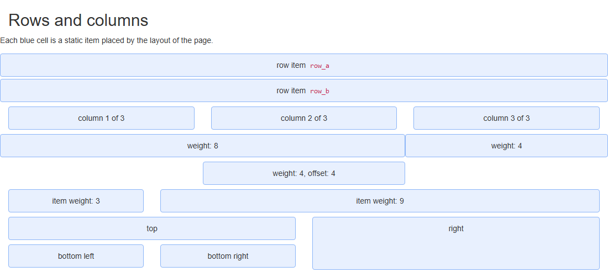
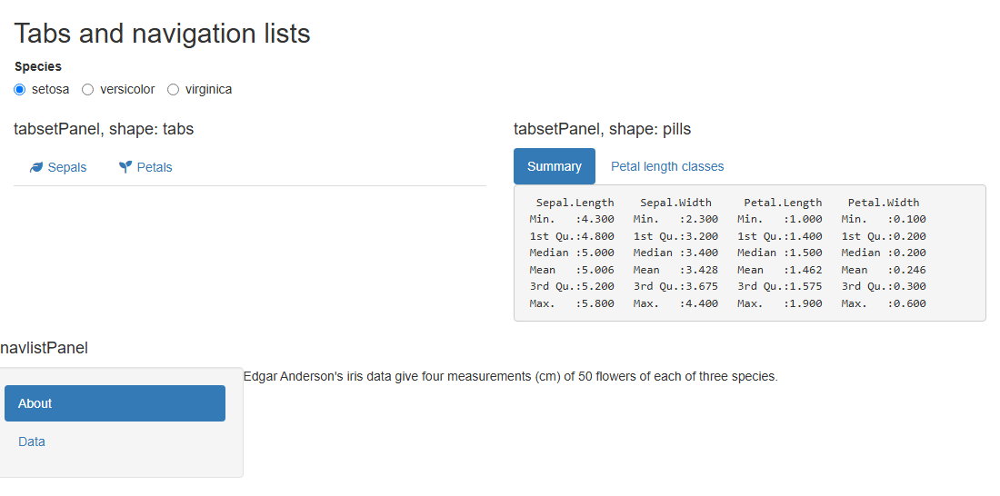
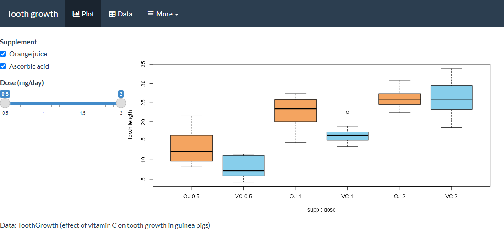
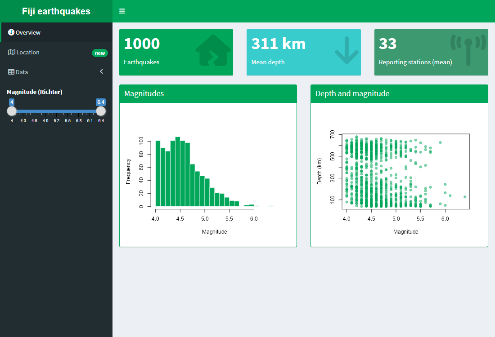
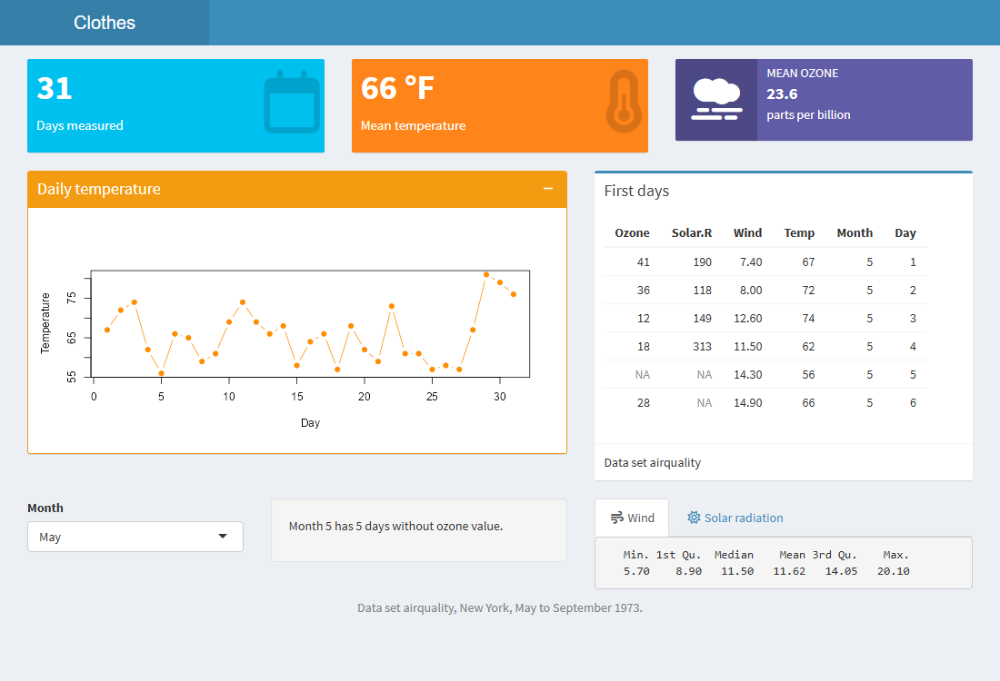

# Dashboards: layouts

The page of a dashboard is made of **containers**: items holding other
items, given by name in their `layout`. This guide shows the page
containers (`fluidPage`, `sidebarLayout`, `navbarPage`,
`dashboardPage`), the grid of rows and columns, tabs, and **clothes**.
All examples come with rvis: run them with
`runDashboard(rvisDashboardExample("<name>"))`. [Getting
started](https://genpack.github.io/rvis/articles/dashboards.md)
introduces dashboards.

## Rows and columns

The layout of a `fluidPage` (and of `tabPanel`, `tabItem` and
`conditionalPanel`) can be a list which is turned into a grid of rows
and columns ([Bootstrap
grid](https://getbootstrap.com/docs/3.4/css/#grid): a row is 12 units
wide):

- the elements of the layout are **rows**;
- a character element (item names) puts its items directly in the row or
  column;
- a list element of a row is a **column**, a list element of a column is
  a **row**, and so on;
- the width of a column is its `weight` (or the mean weight of its
  items), or an equal share of the 12 units. `offset` moves the column
  to the right.

A column with settings is written as a mapping:
`{weight: 4, offset: 1, items: [a, b]}` (the field holding the item
names can have any name).

``` yaml
# Rows and columns: how a list layout is turned into a grid of rows and columns.
# A layout list alternates between rows and columns: the elements of a page layout are rows, the list
# elements of a row are columns, the list elements of a column are rows again, and so on.
# Character elements (item names) are put directly in the row or column.
name: Layout grid
layout: page

items:
  page:
    type: fluidPage
    title: Rows and columns
    layout:
      - [style, intro]
      # a row with two items (no columns): the items are stacked
      - [row_a, row_b]
      # a row with three columns: list elements of a row are columns, each gets 12/3 = 4 grid units
      - - [col_1]
        - [col_2]
        - [col_3]
      # column widths and offsets: weight and offset of the column (12 grid units make a row)
      - - {weight: 8, items: wide}
        - {weight: 4, items: narrow}
      - - {weight: 4, offset: 4, items: centered}
      # columns of single items take the weight and offset of their items
      - - [w3]
        - [w9]
      # a column containing a row of two columns: nested lists
      - - - [top]
          - - [bottom_left]
            - [bottom_right]
        - [right]

  style:
    type: static
    html: |
      <style>
        .cell {background: #e8f0fe; border: 1px solid #8ab4f8; border-radius: 4px; padding: 10px; margin: 4px 0; text-align: center;}
        .cell code {background: none;}
      </style>

  intro:
    type: static
    html: <p>Each blue cell is a static item placed by the layout of the page.</p>

  row_a:        {type: static, html: '<div class="cell">row item <code>row_a</code></div>'}
  row_b:        {type: static, html: '<div class="cell">row item <code>row_b</code></div>'}
  col_1:        {type: static, html: '<div class="cell">column 1 of 3</div>'}
  col_2:        {type: static, html: '<div class="cell">column 2 of 3</div>'}
  col_3:        {type: static, html: '<div class="cell">column 3 of 3</div>'}
  wide:         {type: static, html: '<div class="cell">weight: 8</div>'}
  narrow:       {type: static, html: '<div class="cell">weight: 4</div>'}
  centered:     {type: static, html: '<div class="cell">weight: 4, offset: 4</div>'}
  w3:           {type: static, html: '<div class="cell">item weight: 3</div>', weight: 3}
  w9:           {type: static, html: '<div class="cell">item weight: 9</div>', weight: 9}
  top:          {type: static, html: '<div class="cell">top</div>'}
  bottom_left:  {type: static, html: '<div class="cell">bottom left</div>'}
  bottom_right: {type: static, html: '<div class="cell">bottom right</div>'}
  right:        {type: static, html: '<div class="cell" style="height: 96px;">right</div>'}
```



With `col.framed: true`, the content of each column is put in a well
panel. A character vector layout (`layout: [a, b, c]`) puts each item in
its own row.

## Sidebar layout

A `sidebarLayout` is a page with a title, a side panel (`layout.side`)
and a main panel (`layout.main`). See the [first
dashboard](https://genpack.github.io/rvis/articles/dashboards.md) and
the gallery apps [Telephones by
region](https://genpack.github.io/rvis/articles/dashboard-gallery.html#telephones)
or
[Tabsets](https://genpack.github.io/rvis/articles/dashboard-gallery.html#tabsets).

## Tabs and navigation lists

A `tabsetPanel` shows one of its tab panels at a time (`shape: tabs` or
`pills`, `selected` is the title of the first tab shown). A
`navlistPanel` lists its tabs on the left (`widths` of the list and of
the content). Tab panels are `tabPanel` items, or other items with a
`tabPanel` cloth.

``` yaml
# Tabs: tabset panels (tabs or pills) and a navigation list, made of tab panels.
name: Tabs
layout: page

items:
  page:
    type: fluidPage
    title: Tabs and navigation lists
    layout:
      - [species]
      - - [tabs_title, tabs]
        - [pills_title, pills]
      - [navlist_title, navlist]

  species:
    type: radioButtons
    title: Species
    choices: [setosa, versicolor, virginica]
    inline: true

  tabs_title:    {type: static, html: "<h4>tabsetPanel, shape: tabs</h4>"}
  pills_title:   {type: static, html: "<h4>tabsetPanel, shape: pills</h4>"}
  navlist_title: {type: static, html: "<h4>navlistPanel</h4>"}

  # a tabset panel: its layout gives the tab panels
  tabs:
    type: tabsetPanel
    selected: Sepals
    layout: [sepal_tab, petal_tab]

  # a tab panel has a title, an optional icon and a layout (item names or a list of rows and columns)
  sepal_tab: {type: tabPanel, title: Sepals, icon: leaf, layout: [sepals]}
  petal_tab: {type: tabPanel, title: Petals, icon: seedling, layout: [petals]}

  # tab panels can also be given as clothes of the items
  pills:
    type: tabsetPanel
    shape: pills
    layout: [summary, counts]
  summary:
    type: verbatimTextOutput
    service: summary(iris[iris$Species == input$species, 1:4])
    cloth: {type: tabPanel, title: Summary}
  counts:
    type: tableOutput
    service: as.data.frame(table(cut(iris$Petal.Length[iris$Species == input$species], 4)))
    cloth: {type: tabPanel, title: Petal length classes}

  # a navigation list: tabs listed on the left, widths of the list and the content (12 grid units in total)
  navlist:
    type: navlistPanel
    widths: [3, 9]
    layout: [about_tab, data_tab]
  about_tab: {type: tabPanel, title: About, layout: [about]}
  data_tab:  {type: tabPanel, title: Data, layout: [data]}
  about:
    type: static
    html: <p>Edgar Anderson's iris data give four measurements (cm) of 50 flowers of each of three species.</p>
  data:
    type: tableOutput
    service: head(iris[iris$Species == input$species, ])

  sepals:
    type: plotOutput
    height: 300px
    service: plot(Sepal.Width ~ Sepal.Length, data = iris[iris$Species == input$species, ], pch = 19, col = "#4DAF4A")
  petals:
    type: plotOutput
    height: 300px
    service: plot(Petal.Width ~ Petal.Length, data = iris[iris$Species == input$species, ], pch = 19, col = "#984EA3")
```



## Navigation bar pages

A `navbarPage` has a navigation bar of tab panels and drop-down menus
(`navbarMenu`). Its `theme` is the path of a Bootstrap css file, for
example from package
[shinythemes](https://rstudio.github.io/shinythemes/). The item name is
the id of the page: `input$nav` is the `value` of the selected tab panel
(its item name unless a value is given).

``` yaml
# A navigation bar page with tabs, a drop-down menu and a bootstrap theme (package shinythemes).
name: Navbar page
layout: nav

items:
  nav:
    type: navbarPage
    title: Tooth growth
    # a theme: the path of a bootstrap css file, here from package shinythemes
    theme: !expr shinythemes::shinytheme("flatly")
    collapsible: true
    footer: "Data: ToothGrowth (effect of vitamin C on tooth growth in guinea pigs)"
    layout: [plot_tab, data_tab, more]

  plot_tab:
    type: tabPanel
    title: Plot
    icon: chart-column
    layout:
      - - {weight: 3, items: [supp, dose]}
        - {weight: 9, items: boxplot}

  supp:
    type: checkboxGroupInput
    title: Supplement
    choices: {Orange juice: OJ, Ascorbic acid: VC}
    selected: [OJ, VC]

  dose:
    type: sliderInput
    title: Dose (mg/day)
    min: 0.5
    max: 2
    value: [0.5, 2]
    step: 0.5

  boxplot:
    type: plotOutput
    service: |
      d <- ToothGrowth[ToothGrowth$supp %in% input$supp & ToothGrowth$dose >= input$dose[1] & ToothGrowth$dose <= input$dose[2], ]
      validate(need(nrow(d) > 0, "Select at least one supplement."))
      boxplot(len ~ supp + dose, data = droplevels(d), col = c("#F4A460", "#87CEEB"), ylab = "Tooth length")

  data_tab:
    type: tabPanel
    title: Data
    icon: table
    layout: [table]

  table:
    type: dataTableOutput
    options: {pageLength: 10}
    service: ToothGrowth

  # a drop-down menu of tab panels
  more:
    type: navbarMenu
    title: More
    icon: bars
    layout: [summary_tab, about_tab]

  summary_tab: {type: tabPanel, title: Summary, layout: [summary]}
  about_tab:   {type: tabPanel, title: About, layout: [about]}

  summary:
    type: verbatimTextOutput
    service: aggregate(len ~ supp + dose, data = ToothGrowth, FUN = mean)

  about:
    type: static
    html: <p>The response is the length of odontoblasts in 60 guinea pigs, each receiving one of three dose levels of vitamin C by one of two delivery methods.</p>
```



## shinydashboard pages

A `dashboardPage`
([shinydashboard](https://rstudio.github.io/shinydashboard/)) has a
header (`layout.head`, title settings `header.title...`), a sidebar
(`layout.side`) and a body (`layout.body`). Several pages are made with
a `sidebarMenu` of `menuItem`s (with optional `menuSubItem`s) and
`tabItems` holding `tabItem`s: a menu item shows the tab item with the
same `tabName` (the name of the tab item by default). The sidebar menu
is an input: `input$menu` is the selected tab.

``` yaml
# A shinydashboard page: header, sidebar with a menu, and body pages (tab items) selected by the menu.
name: Earthquakes
layout: dash

items:
  dash:
    type: dashboardPage
    title: Earthquakes off Fiji
    skin: green
    # header title and its style
    header.title: Fiji earthquakes
    header.title.width: 250
    header.title.font: verdana
    header.title.font.weight: bold
    header.title.hover.background.color: darkgreen
    sidebar.width: 250
    layout.side: [menu, magnitude]
    layout.body: [pages]

  # the sidebar menu: menu items select the tab items of the body with the same tabName
  menu:
    type: sidebarMenu
    layout: [overview_menu, map_menu, data_menu]

  overview_menu: {type: menuItem, title: Overview, tabName: overview, icon: gauge}
  map_menu:      {type: menuItem, title: Location, tabName: location, icon: map, badgeLabel: new, badgeColor: green}
  # a menu item with sub-items
  data_menu:
    type: menuItem
    title: Data
    icon: table
    layout: [table_menu, summary_menu]
  table_menu:   {type: menuSubItem, title: Table, tabName: table}
  summary_menu: {type: menuSubItem, title: Summary, tabName: summary}

  magnitude:
    type: sliderInput
    title: Magnitude (Richter)
    min: 4
    max: 6.4
    value: [4, 6.4]
    step: 0.1

  # the body pages
  pages:
    type: tabItems
    layout: [overview, location, table, summary]

  overview:
    type: tabItem
    layout:
      - [count, depth, stations]
      - [histogram, depth_plot]
  location:
    type: tabItem
    layout: [map]
  table:
    type: tabItem
    layout: [quakes_table]
  summary:
    type: tabItem
    layout: [quakes_summary]

  # value box outputs: the service returns a value box
  count:
    type: valueBoxOutput
    weight: 4
    service: valueBox(sum(quakes$mag >= input$magnitude[1] & quakes$mag <= input$magnitude[2]), "Earthquakes", icon = icon("house-crack"), color = "green")
  depth:
    type: valueBoxOutput
    weight: 4
    service: valueBox(paste(round(mean(quakes$depth[quakes$mag >= input$magnitude[1] & quakes$mag <= input$magnitude[2]])), "km"), "Mean depth", icon = icon("arrow-down"), color = "teal")
  stations:
    type: valueBoxOutput
    weight: 4
    service: valueBox(round(mean(quakes$stations[quakes$mag >= input$magnitude[1] & quakes$mag <= input$magnitude[2]])), "Reporting stations (mean)", icon = icon("tower-broadcast"), color = "olive")

  histogram:
    type: plotOutput
    height: 300px
    service: hist(quakes$mag[quakes$mag >= input$magnitude[1] & quakes$mag <= input$magnitude[2]], breaks = 20, col = "#00A65A", border = "white", main = "", xlab = "Magnitude")
    cloth: {type: box, title: Magnitudes, status: success, solidHeader: true, weight: 6}
  depth_plot:
    type: plotOutput
    height: 300px
    service: plot(depth ~ mag, data = quakes[quakes$mag >= input$magnitude[1] & quakes$mag <= input$magnitude[2], ], pch = 19, col = "#00A65A80", xlab = "Magnitude", ylab = "Depth (km)")
    cloth: {type: box, title: Depth and magnitude, status: success, solidHeader: true, weight: 6}

  map:
    type: plotOutput
    height: 500px
    service: |
      d <- quakes[quakes$mag >= input$magnitude[1] & quakes$mag <= input$magnitude[2], ]
      plot(lat ~ long, data = d, pch = 19, cex = d$mag - 3.5, col = "#00A65A80", xlab = "Longitude", ylab = "Latitude", asp = 1)
    cloth: {type: box, title: Locations (point size is the magnitude), weight: 12}

  quakes_table:
    type: dataTableOutput
    service: quakes[quakes$mag >= input$magnitude[1] & quakes$mag <= input$magnitude[2], ]
    cloth: {type: box, title: Earthquakes, weight: 12}

  quakes_summary:
    type: verbatimTextOutput
    service: summary(quakes[quakes$mag >= input$magnitude[1] & quakes$mag <= input$magnitude[2], ])
    cloth: {type: box, title: Summary, weight: 12}
```



The header title can be styled: `header.title.color`,
`header.title.background.color`, `header.title.font`,
`header.title.font.weight` and `header.title.font.size`, and the same
with `header.title.hover...` when the mouse is over it.

## Clothes

The `cloth` of an item wraps it in another element, without a container
item:

| Cloth `type` | Settings |
|:---|:---|
| `box` | `title`, `footer`, `status` (primary, success, info, warning, danger), `solidHeader`, `background` (a colour), `weight`, `height`, `style`, `collapsible`, `collapsed` |
| `valueBox` | `title` (the subtitle under the value), `icon`, `color`, `weight`, `href` |
| `infoBox` | `title`, `subtitle`, `icon`, `color`, `weight`, `href`, `fill` |
| `column` | `weight`, `offset`, `align` |
| `wellPanel` |  |
| `tabPanel` | `title`, `icon`, `value` |

The value of a value box or info box is the result of the service of the
item (use a `uiOutput`). If the item has a `title`, it is used as the
title of its cloth.

``` yaml
# Clothes: any item can be wrapped in a box, info box, value box, column, well panel or tab panel
# with its 'cloth' field, without defining a container item.
name: Clothes
layout: dash

items:
  dash:
    type: dashboardPage
    title: Clothes
    header.title: Clothes
    layout.body: [kpis, boxes, others, footer]

  # rows of the body: boxes have a width, so they can be put in a row directly
  kpis:   {type: fluidPage, layout: [[days, temperature, ozone]]}
  boxes:  {type: fluidPage, layout: [[plot, table]]}
  # a row of three columns (a list of lists): the column widths are the weights of their items
  others: {type: fluidPage, layout: [[[month], [notes], [tabs]]]}
  footer: {type: fluidPage, layout: [[source]]}

  month:
    type: selectInput
    title: Month
    choices: {May: 5, June: 6, July: 7, August: 8, September: 9}
    weight: 3

  # value box and info box clothes (shinydashboard): the service gives the value
  days:
    type: uiOutput
    service: sum(airquality$Month == input$month)
    cloth: {type: valueBox, title: Days measured, icon: calendar, color: aqua, weight: 4}

  temperature:
    type: uiOutput
    service: paste(round(mean(airquality$Temp[airquality$Month == input$month])), "°F")
    cloth: {type: valueBox, title: Mean temperature, icon: temperature-half, color: orange, weight: 4}

  ozone:
    type: uiOutput
    service: round(mean(airquality$Ozone[airquality$Month == input$month], na.rm = TRUE), 1)
    cloth: {type: infoBox, title: Mean ozone, subtitle: parts per billion, icon: smog, color: purple, weight: 4, fill: true}

  # box clothes
  plot:
    type: plotOutput
    height: 250px
    service: |
      d <- airquality[airquality$Month == input$month, ]
      plot(d$Day, d$Temp, type = "b", pch = 19, col = "darkorange", xlab = "Day", ylab = "Temperature")
    cloth: {type: box, title: Daily temperature, status: warning, solidHeader: true, collapsible: true, weight: 7}

  table:
    type: tableOutput
    service: head(airquality[airquality$Month == input$month, ], 6)
    cloth: {type: box, title: First days, footer: Data set airquality, status: primary, weight: 5}

  # a well panel cloth
  notes:
    type: htmlOutput
    service: tags$p("Month", input$month, "has", sum(is.na(airquality$Ozone[airquality$Month == input$month])), "days without ozone value.")
    cloth: {type: wellPanel}
    weight: 4

  # tab panel clothes: items of a tabset panel
  tabs:
    type: tabsetPanel
    layout: [wind, solar]
    weight: 5
  wind:
    type: verbatimTextOutput
    service: summary(airquality$Wind[airquality$Month == input$month])
    cloth: {type: tabPanel, title: Wind, icon: wind}
  solar:
    type: verbatimTextOutput
    service: summary(airquality$Solar.R[airquality$Month == input$month])
    cloth: {type: tabPanel, title: Solar radiation, icon: sun}

  # a column cloth: the item is put in a column of the given weight and offset
  source:
    type: static
    html: <p style="text-align:center; color:grey;">Data set airquality, New York, May to September 1973.</p>
    cloth: {type: column, weight: 6, offset: 3}
```



## Other containers

| Container | Settings | Content |
|:---|:---|:---|
| `column` | `weight`, `offset` | the items of `layout` in a column |
| `box` | `title`, `footer`, `status`, `solidHeader`, `background` (default `blue`), `weight`, `collapsible`, `collapsed` | a shinydashboard box |
| `wellPanel` |  | a panel with a grey background |
| `bag` |  | a plain `div` (items one after the other) |
| `conditionalPanel` | `condition` (javascript, like `input.n > 5`) | shown only when the condition is true |
| `bsModal` | `title`, `trigger` (id of the button opening it), `size` | a modal window (shinyBS) |
| `bsCollapse`, `bsCollapsePanel` | `multiple`, `open`; `title`, `value`, `style` | collapsible panels (shinyBS) |
| `tutorBox` | `tutor.lesson`, `tutor.step`, `tutor.hint` | a group highlighted in a guided tour (rintrojs) |

Containers can have a cloth too, for example a `bag` of items with a
`box` cloth. The [item
reference](https://genpack.github.io/rvis/articles/dashboard-reference.md)
gives all settings, and examples of modals, collapsible panels and
guided tours.

## Several items on the page

`layout` can list several items: they are put on the page one after the
other. The [shinythemes gallery
app](https://genpack.github.io/rvis/articles/dashboard-gallery.html#shinythemes)
uses this to put a theme selector above a navbar page.
