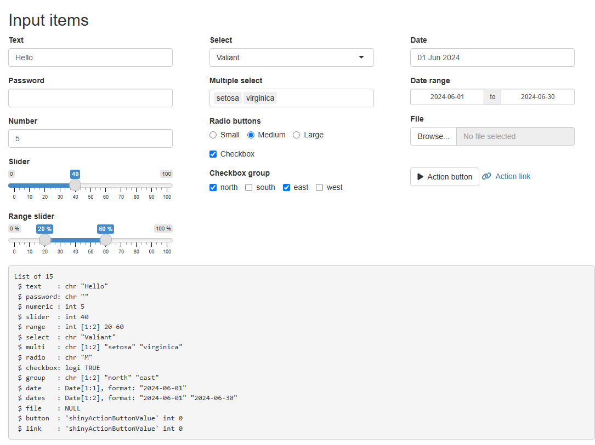
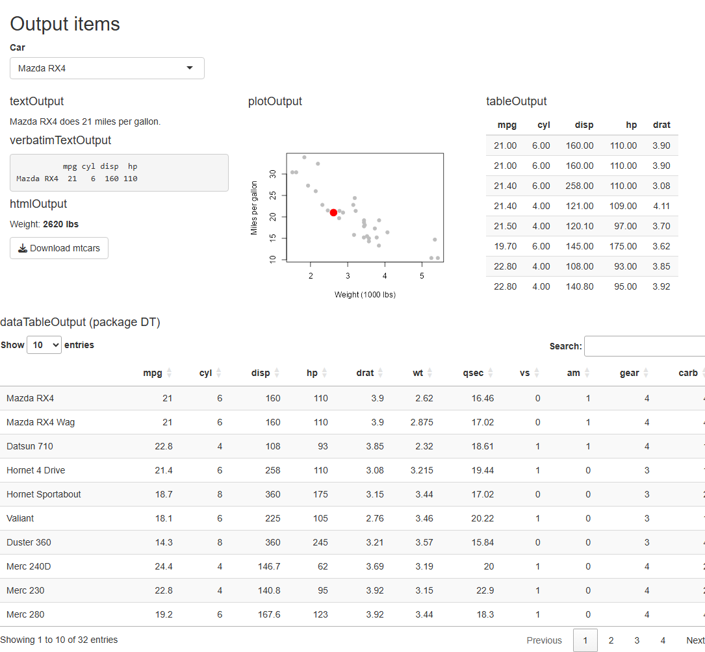
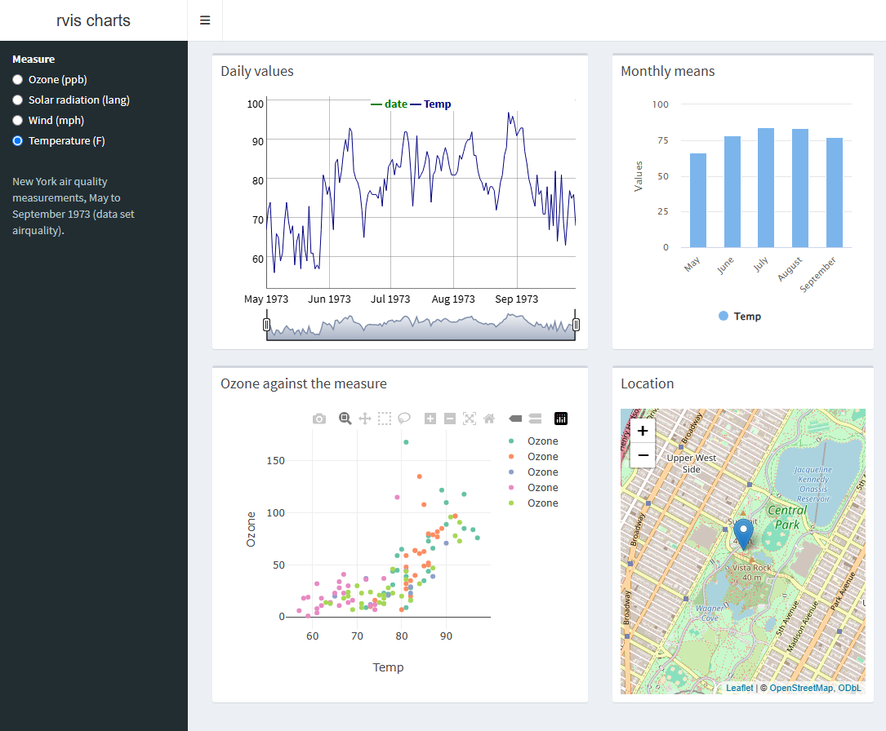
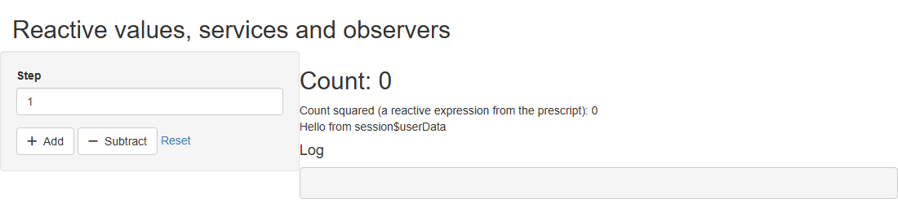
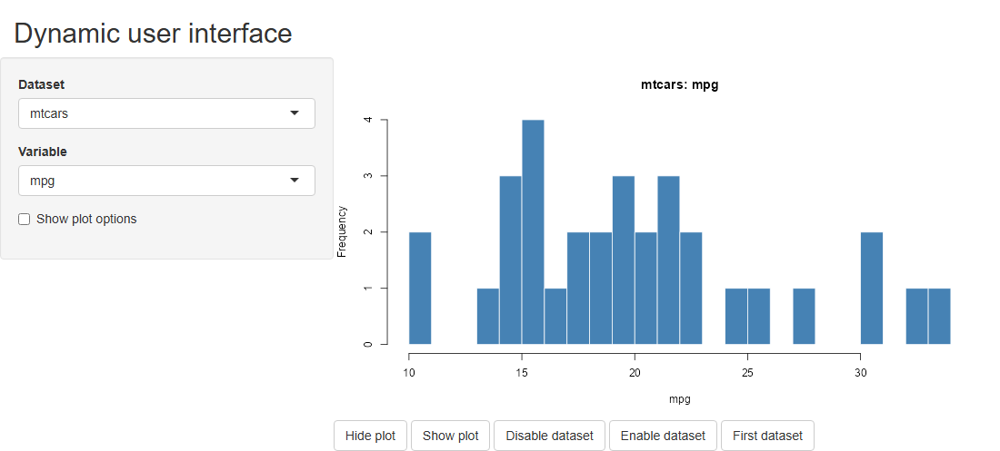
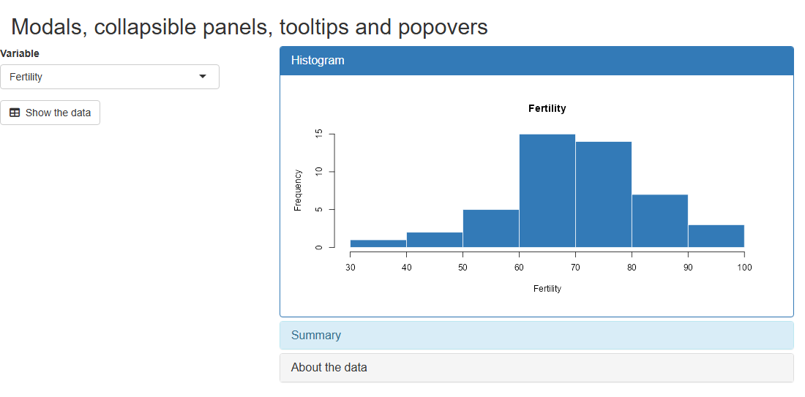
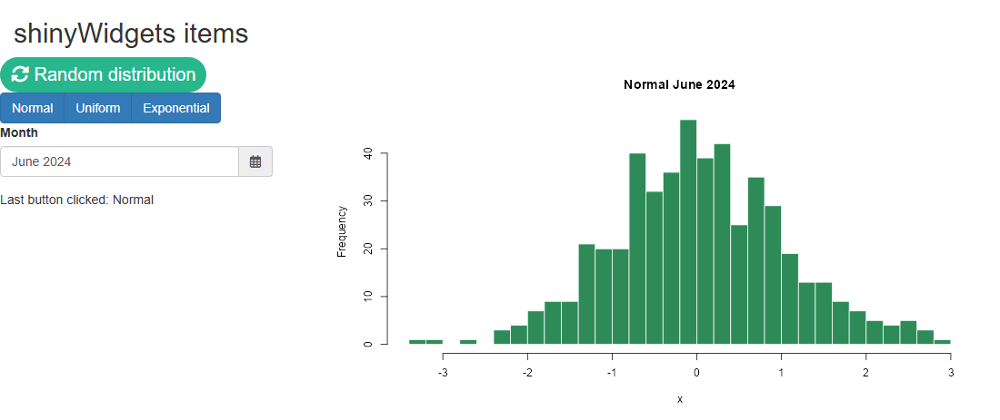
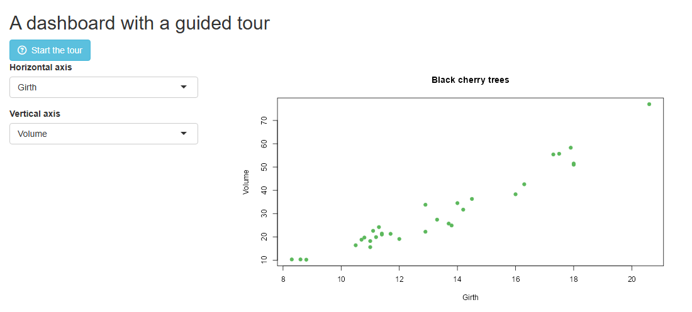
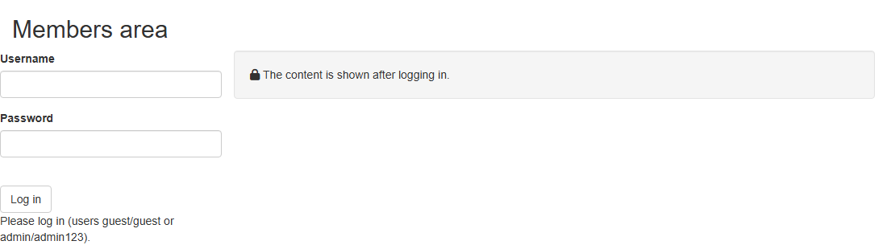
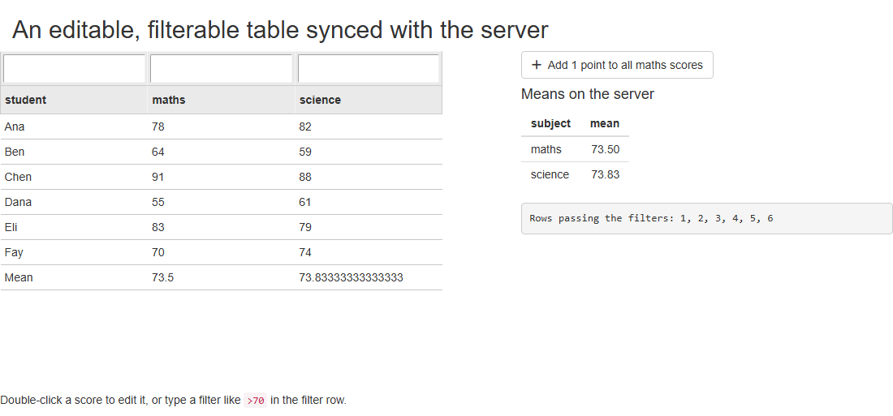

# Dashboards: item reference

This reference lists every item type of a dashboard and its settings,
the server environment of the services, and the special features:
reactive values, dynamic interfaces, tooltips and popovers, modal
windows, guided tours, login and synced tables. Each feature has an
example dashboard that comes with rvis
(`runDashboard(rvisDashboardExample("<name>"))`). Containers and clothes
are described in
[Layouts](https://genpack.github.io/rvis/articles/dashboard-layouts.md).

## Settings of all items

| Setting | Meaning |
|:---|:---|
| `type` | The item type (required). |
| `title` | Label of an input, title of a container or of the cloth of the item. |
| `service` | R code: the content of an output, or code run when an input changes. |
| `weight`, `offset` | Width and offset (in 12ths of the row) of the column holding the item, in row/column layouts. |
| `cloth` | A box, value box, info box, column, well panel or tab panel around the item ([clothes](https://genpack.github.io/rvis/articles/dashboard-layouts.html#clothes)). |
| `tooltip`, `tooltip.placement`, `tooltip.trigger`, `tooltip.options` | A tooltip ([shinyBS](https://ebailey78.github.io/shinyBS/)). Placement: `top`, `bottom` (default), `left`, `right`; trigger: `hover` (default), `focus`, `click`, `manual`. |
| `popover`, `popover.title`, `popover.placement`, `popover.trigger`, `popover.options` | A popover (html allowed). |
| `tutor.lesson`, `tutor.step`, `tutor.hint` | A lesson of the guided tour ([rintrojs](https://carlganz.github.io/rintrojs/)). |

## Inputs

The name of an input item is its id (`input$<name>`). `title` is its
label. The `service` of an input is run (in
[`observeEvent()`](https://rdrr.io/pkg/shiny/man/observeEvent.html))
when the input changes; with `isolate: true` it is run in
[`isolate()`](https://rdrr.io/pkg/shiny/man/isolate.html). `choices` and
`selected` can be vectors or mappings of labels to values.

| Type | Settings |
|:---|:---|
| `textInput`, `passwordInput` | `value`, `width`, `placeholder` |
| `numericInput` | `value`, `min`, `max`, `step` |
| `sliderInput` | `min`, `max`, `value` (two values for a range), `step`, `round`, `ticks`, `sep`, `pre`, `post`, `animate` (`true` or `!expr animationOptions(...)`), `dragRange`, `timeFormat`, `timezone`, `width` |
| `selectInput` | `choices`, `selected`, `multiple`, `selectize`, `width` |
| `radioButtons` | `choices`, `selected`, `inline`, `width` |
| `checkboxInput` | `value`, `inline`, `vertical_align`, `float` |
| `checkboxGroupInput` | `choices`, `selected` (or `choiceNames` and `choiceValues`), `inline`, `width` |
| `dateInput` | `value`, `min`, `max`, `format`, `startview`, `weekstart`, `language`, `autoclose`, `datesdisabled`, `daysofweekdisabled`, `width` |
| `dateRangeInput` | `start`, `end`, `min`, `max`, `format`, `startview`, `weekstart`, `language`, `separator`, `autoclose`, `width` |
| `fileInput` | `multiple`, `accept`, `buttonLabel`, `placeholder`, `width` |
| `actionButton` | `icon`, `class` (like `btn-primary`), `width`, `inline`, `vertical_align`, `float` |
| `actionLink` | `icon` |
| `actionBttn` ([shinyWidgets](https://dreamrs.github.io/shinyWidgets/)) | `icon`, `style`, `status`, `size`, `fullwidth`, `no_outline` |
| `actionGroupButtons` (shinyWidgets) | `inputIds`, `labels`, `status`, `size`, `inline`, `fullwidth` |
| `airDatepickerInput` (shinyWidgets) | `value`, `min`, `max`, `range`, `multiple`, `view`, `minView`, `dateFormat`, `timePicker`, `language`, `clearButton`, `todayButton`, `autoClose`, `inline`, … |

Icons are [Font Awesome](https://fontawesome.com/search?ic=free) names,
like `play`.

``` yaml
# All shiny input items, in three columns, and their current values.
name: Input items
layout: page

items:
  page:
    type: fluidPage
    title: Input items
    layout:
      # first row: three columns (a list of three lists of item names)
      - - [text, password, numeric, slider, range]
        - [select, multi, radio, checkbox, group]
        - [date, dates, file, button, link]
      # second row: the values
      - [values]

  text:     {type: textInput, title: Text, value: Hello, placeholder: type something}
  password: {type: passwordInput, title: Password}
  numeric:  {type: numericInput, title: Number, value: 5, min: 0, max: 10, step: 0.5}
  slider:   {type: sliderInput, title: Slider, min: 0, max: 100, value: 40}
  range:    {type: sliderInput, title: Range slider, min: 0, max: 100, value: [20, 60], post: " %"}

  select:
    type: selectInput
    title: Select
    choices: !expr rownames(mtcars)
    selected: Valiant
  multi:
    type: selectInput
    title: Multiple select
    choices: [setosa, versicolor, virginica]
    selected: [setosa, virginica]
    multiple: true
  # choices with labels: label -> value
  radio:
    type: radioButtons
    title: Radio buttons
    choices: {Small: S, Medium: M, Large: L}
    selected: M
    inline: true
  checkbox: {type: checkboxInput, title: Checkbox, value: true}
  group:
    type: checkboxGroupInput
    title: Checkbox group
    choices: [north, south, east, west]
    selected: [north, east]
    inline: true

  date:   {type: dateInput, title: Date, value: 2024-06-01, format: dd M yyyy}
  dates:  {type: dateRangeInput, title: Date range, start: 2024-06-01, end: 2024-06-30}
  file:   {type: fileInput, title: File, accept: [.csv, .txt]}
  button: {type: actionButton, title: Action button, icon: play}
  link:   {type: actionLink, title: Action link, icon: link}

  values:
    type: verbatimTextOutput
    service: |
      ids <- c("text", "password", "numeric", "slider", "range", "select", "multi", "radio",
               "checkbox", "group", "date", "dates", "file", "button", "link")
      str(setNames(lapply(ids, function(id) input[[id]]), ids))
```



## Outputs

The `service` of an output is the R code of its render function: the
output is updated when an input or reactive value used by the service
changes.

| Type | Render function | Settings |
|:---|:---|:---|
| `textOutput` | [`renderText()`](https://rdrr.io/pkg/shiny/man/renderPrint.html) | `tag` (html tag of the text, like `h3`), `inline` |
| `verbatimTextOutput` | [`renderPrint()`](https://rdrr.io/pkg/shiny/man/renderPrint.html) | `placeholder` |
| `htmlOutput` | [`renderUI()`](https://rdrr.io/pkg/shiny/man/renderUI.html) | `tag`, `inline` |
| `uiOutput` | [`renderText()`](https://rdrr.io/pkg/shiny/man/renderPrint.html) (the text is html) | `tag`, `inline`; used for the value of value box and info box clothes |
| `dynamicInput` | [`renderUI()`](https://rdrr.io/pkg/shiny/man/renderUI.html) | `inline`; the service returns inputs or any user interface |
| `plotOutput` | [`renderPlot()`](https://rdrr.io/pkg/shiny/man/renderPlot.html) | `width`, `height`, `click`, `dblclick`, `hover`, `brush` (ids of the inputs reporting mouse events), `spinner`, `spinner.color` (shinyWidgets) |
| `imageOutput` | [`renderImage()`](https://rdrr.io/pkg/shiny/man/renderImage.html) | `deleteFile` |
| `tableOutput` | [`renderTable()`](https://rdrr.io/pkg/shiny/man/renderTable.html) | `striped`, `hover`, `bordered`, `spacing`, `width`, `align`, `rownames`, `colnames`, `digits`, `na` |
| `dataTableOutput` | [`DT::renderDataTable()`](https://rdrr.io/pkg/DT/man/dataTableOutput.html) | `width`, `height`, `options` (DataTables options) |
| `valueBoxOutput`, `infoBoxOutput` | `renderValueBox()`, `renderInfoBox()` | `weight` |
| `downloadButton`, `downloadLink` | [`downloadHandler()`](https://rdrr.io/pkg/shiny/man/downloadHandler.html) | `title`, `filename` (R code), `class`, `style`; the service writes the content into `file` |
| `static` | none | `html` (html text) or `object` (any shiny tag, like `!expr hr()`) |

``` yaml
# The standard shiny output items. Each output has a service: R code returning its content.
name: Output items
layout: page

items:
  page:
    type: fluidPage
    title: Output items
    layout:
      - [cars]
      - - [text_title, text, verbatim_title, verbatim, html_title, html, download]
        - [plot_title, plot]
        - [table_title, table]
      - [dt_title, dt]

  cars:
    type: selectInput
    title: Car
    choices: !expr rownames(mtcars)

  text_title:     {type: static, html: <h4>textOutput</h4>}
  verbatim_title: {type: static, html: <h4>verbatimTextOutput</h4>}
  html_title:     {type: static, html: <h4>htmlOutput</h4>}
  plot_title:     {type: static, html: <h4>plotOutput</h4>}
  table_title:    {type: static, html: <h4>tableOutput</h4>}
  dt_title:       {type: static, html: <h4>dataTableOutput (package DT)</h4>}

  # text
  text:
    type: textOutput
    service: paste(input$cars, "does", mtcars[input$cars, "mpg"], "miles per gallon.")

  # printed output
  verbatim:
    type: verbatimTextOutput
    service: mtcars[input$cars, 1:4]

  # html (the service returns html tags)
  html:
    type: htmlOutput
    service: tags$p("Weight:", tags$b(mtcars[input$cars, "wt"] * 1000, "lbs"))

  # a plot
  plot:
    type: plotOutput
    height: 300px
    service: |
      plot(mtcars$wt, mtcars$mpg, xlab = "Weight (1000 lbs)", ylab = "Miles per gallon", pch = 19, col = "grey")
      points(mtcars[input$cars, "wt"], mtcars[input$cars, "mpg"], pch = 19, col = "red", cex = 2)

  # a table, with arguments of renderTable(): striped, hover, digits, ...
  table:
    type: tableOutput
    striped: true
    hover: true
    digits: 1
    service: head(mtcars[order(abs(mtcars$mpg - mtcars[input$cars, "mpg"])), 1:5], 8)

  # an interactive table, with DataTables options
  dt:
    type: dataTableOutput
    options: {pageLength: 5}
    service: mtcars

  # a download button: filename and service are R code; the service writes the file
  download:
    type: downloadButton
    title: Download mtcars
    filename: '"mtcars.csv"'
    service: write.csv(mtcars, file)
```



### htmlwidgets outputs

These outputs show htmlwidgets made by their service, for example rvis
charts made by
[`rvisPlot()`](https://genpack.github.io/rvis/reference/rvisPlot.md).
They have `width` and `height` settings (defaults in brackets).

| Type                  | Package                        | Default size |
|:----------------------|:-------------------------------|:-------------|
| `highcharterOutput`   | highcharter                    | 100%, 400px  |
| `plotlyOutput`        | plotly                         | 100%, 400px  |
| `dygraphOutput`       | dygraphs                       | 100%, 400px  |
| `leafletOutput`       | leaflet                        | 100%, 400px  |
| `amChartsOutput`      | rAmCharts                      | 100%, 400px  |
| `billboarderOutput`   | billboarder                    | 100%, 400px  |
| `c3Output`            | c3                             | 100%, 100%   |
| `morrisjsOutput`      | morrisjs                       | 100%, 400px  |
| `d3plusOutput`        | d3plus                         | 100%, 500px  |
| `bubblesOutput`       | bubbles                        | 600px, 600px |
| `sankeyNetworkOutput` | networkD3                      | 100%, 500px  |
| `sankeytreeOutput`    | sankeytreeR                    | 100%, 400px  |
| `coffeewheelOutput`   | rvis (embedded)                | 400, 400     |
| `grvizOutput`         | DiagrammeR (rvis grviz graphs) | 100%, 400px  |
| `wordcloud2Output`    | wordcloud2                     | 100%, 400px  |
| `sunburstOutput`      | sunburstR                      | 100%, 400px  |
| `upsetjsOutput`       | upsetjs                        | 100%, 500px  |
| `pivotOutput`         | rpivotTable                    | 100%, 500px  |
| `TFD3Output`          | rvis (embedded)                | 100%, 400px  |
| `d3tfOutput`          | D3TableFilter                  | 100%, 400px  |
| `rHandsonTableOutput` | rhandsontable                  | 100%, 100%   |
| `gglVisChartOutput`   | googleVis                      |              |
| `rChartsdPlotOutput`  | rCharts (dimple)               |              |

``` yaml
# rvis charts in a dashboard: services return rvisPlot() charts (htmlwidgets) shown by the output of their plotter.
# Needs packages dygraphs, highcharter, plotly and leaflet.
name: rvis charts
layout: dash

prescript: |
  air <- airquality
  air$date <- as.Date(paste(1973, air$Month, air$Day, sep = "-"))
  air$month <- month.name[air$Month]
  monthly <- aggregate(cbind(Ozone, Solar.R, Wind, Temp) ~ month, data = air, FUN = mean)
  monthly <- monthly[order(match(monthly$month, month.name)), ]

items:
  dash:
    type: dashboardPage
    header.title: rvis charts
    skin: black
    layout.side: [variable, about]
    layout.body: [row1, row2]

  variable:
    type: radioButtons
    title: Measure
    choices: {Ozone (ppb): Ozone, Solar radiation (lang): Solar.R, Wind (mph): Wind, Temperature (F): Temp}
    selected: Temp

  about:
    type: static
    html: <p style="padding:15px; color:#b8c7ce;">New York air quality measurements, May to September 1973 (data set airquality).</p>

  row1: {type: fluidPage, layout: [[trend, bars]]}
  row2: {type: fluidPage, layout: [[scatter, map]]}

  # dygraphs time series
  trend:
    type: dygraphOutput
    height: 300px
    service: rvisPlot(type = "tsline", plotter = "dygraphs", obj = air, x = "date", y = input$variable)
    cloth: {type: box, title: Daily values, weight: 7}

  # highcharter bar chart
  bars:
    type: highcharterOutput
    height: 300px
    service: rvisPlot(type = "bar", plotter = "highcharter", obj = monthly, x = "month", y = input$variable)
    cloth: {type: box, title: Monthly means, weight: 5}

  # plotly scatter chart
  scatter:
    type: plotlyOutput
    height: 350px
    service: rvisPlot(type = "scatter", plotter = "plotly", obj = air[!is.na(air[[input$variable]]) & !is.na(air$Ozone), ], x = input$variable, y = "Ozone", color = "month")
    cloth: {type: box, title: Ozone against the measure, weight: 7}

  # a leaflet map (any htmlwidget made by the service can be shown by its output type)
  map:
    type: leafletOutput
    height: 350px
    service: |
      leaflet::leaflet() %>%
        leaflet::addTiles() %>%
        leaflet::addMarkers(lng = -73.97, lat = 40.78, popup = "Central Park, New York")
    cloth: {type: box, title: Location, weight: 5}
```



Any other htmlwidget can be an output with a `package::function` type,
like `type: echarts4r::echarts4rOutput` or
`type: apexcharter::apexchartOutput`: the item fields are the arguments
of the output function and the service is rendered by the package’s
render function (see [any function as an item](#generic)).

### Clicks on chart items

An htmlwidget output with `click.events: true` sends clicks on the items
of its chart to the input `<item name>_item_click`, which services and
observers can use like any input. Its value is a list with the `type` of
the clicked item (`node`, `link`, `point` or `element`) and, as
available, its `id`, `label`, `series`, `index`, `value`, `x`, `y`, and
the `source` and `target` of a link. Nodes of rvis `grviz` graphs are
reported by their key.

This works for Graphviz diagrams (rvis `grviz` and DiagrammeR),
networkD3, echarts4r, apexcharter, plotly, highcharter, rAmCharts, c3,
billboarder, visNetwork, dygraphs and leaflet charts, DT tables (a click
on a cell gives its `row`, `column` and `value`) and rvis coffeewheel
sunbursts. The click javascript is added to the chart with
[`htmlwidgets::onRender()`](https://rdrr.io/pkg/htmlwidgets/man/onRender.html)
by
[`rvisClickEvents()`](https://genpack.github.io/rvis/reference/rvisClickEvents.md):
the plotting packages are used as they are, so their new versions keep
working. For other widgets, call
[`rvisClickEvents()`](https://genpack.github.io/rvis/reference/rvisClickEvents.md)
in the service with a CSS `selector` of the clickable elements, for
example `rvisClickEvents(sunburstR::sunburst(data), selector = "path")`.

``` yaml
# Clicks on chart items as shiny inputs.
# An output with 'click.events: true' sends clicks on the items of its chart (nodes, links, bars, points, ...)
# to input <output name>_item_click: a list with the type, id, label, series, value, ... of the clicked item.
# This works for Graphviz diagrams (rvis grviz and DiagrammeR), networkD3, echarts4r, apexcharter, plotly and
# highcharter charts; see ?rvisClickEvents for other widgets.
name: Click events
layout: page

objects:
  network:
    nodes: !expr data.frame(id = c('raw', 'clean', 'model', 'report'), label = c('Raw data', 'Cleaning', 'Model', 'Report'))
    links: !expr data.frame(source = c('raw', 'clean', 'model', 'clean'), target = c('clean', 'model', 'report', 'report'))

items:
  page:
    type: fluidPage
    title: Click a node, a link or a bar
    # a row of two columns (graph and bars), then a row with the clicked items
    layout: [[[graph], [bars]], [clicked]]

  graph:
    type: grvizOutput
    height: 350px
    weight: 6
    click.events: true
    service: |
      rvisPlot(type = 'graph', plotter = 'grviz', obj = session$userData$network,
               key = 'id', label = 'label', source = 'source', target = 'target')

  bars:
    type: echarts4r::echarts4rOutput
    height: 350px
    weight: 6
    click.events: true
    service: |
      deaths <- data.frame(age = rownames(VADeaths), VADeaths, check.names = FALSE)
      rvisPlot(type = 'bar', plotter = 'echarts', obj = deaths, x = 'age', y = list('Rural Male', 'Urban Male'))

  clicked:
    type: verbatimTextOutput
    service: |
      cat('Graph:\n'); str(input$graph_item_click)
      cat('\nBars:\n'); str(input$bars_item_click)
```

The [interactive
charts](https://genpack.github.io/rvis/articles/click-events.md) guide
describes the value of the input for each plotter.

## Any function as an item

The `type` of an item (or of its `cloth`) can be any function of any
package, written as `package::function`, like
[`shinyWidgets::pickerInput`](https://dreamrs.github.io/shinyWidgets/reference/pickerInput.html),
[`shinydashboard::box`](https://rdrr.io/pkg/shinydashboard/man/box.html)
or
[`apexcharter::apexchartOutput`](https://dreamrs.github.io/apexcharter/reference/apexcharter-shiny.html).
The function is called with the fields of the item as its arguments, as
they are: use the argument names of the package documentation (for
example `label`, not `title`, for the label of
[`shiny::selectInput`](https://rdrr.io/pkg/shiny/man/selectInput.html)).
So every function of every package, including functions added in their
future versions, can be a dashboard item without changes to rvis.

The role of the item is found from the arguments of its function:

- **inputs**: functions with argument `inputId` get the item name as
  `inputId`. Their `service` runs when the input changes, and
  `updateItem4Session()` / `updateItem()` call the package’s update
  function (`fooInput` is updated by `updateFooInput`).
- **outputs**: functions with argument `outputId` get the item name as
  `outputId`. Their `service` is rendered by the package’s render
  function matching the output function (`fooOutput` by `renderFoo`).
- **containers**: all other functions get the items of their `layout` as
  unnamed arguments (and the item name as `id`, if they have an argument
  `id` and the item has none).

A few fields are used by rvis and not passed to the function:

| Field | Use |
|:---|:---|
| `args` | unnamed arguments passed first, like the text of [`shiny::h3`](https://rstudio.github.io/htmltools/reference/builder.html) |
| `service`, `layout`, `cloth` | as for all items |
| `role` | `input`, `output` or `container`, if the role found from the arguments is wrong |
| `render` | render function of an output, like `my.package::renderThing`, if it is not named `renderFoo` |
| `render.args` | list of arguments of the render function |
| `update` | function updating an input, if it is not named `updateFoo` |
| `click.events` | for htmlwidget outputs: [clicks on chart items](#clicks) as an input |
| `weight`, `offset` | width and offset of the item in a [row/column layout](https://genpack.github.io/rvis/articles/dashboard-layouts.html#grid); passed to the function only if it has such an argument (like [`shiny::column`](https://rdrr.io/pkg/shiny/man/column.html)) |
| tooltip, popover and tutor fields | as for all items |

The short type names of the other sections (like `selectInput` or `box`)
keep their own settings, like `title` for the label of an input.

``` yaml
# Any function of any package can be an item type: write the type as package::function.
# The item fields are passed to the function as they are (same argument names as in the package documentation).
#  - inputs  (functions with argument inputId) get the item name as inputId; their service runs when the input changes
#  - outputs (functions with argument outputId) get the item name as outputId; their service is rendered by the
#    matching render function of the package (fooOutput -> renderFoo) or by the function given in field 'render'
#  - containers (all other functions) get the items of their layout as unnamed arguments; field 'args' gives
#    unnamed arguments passed first, like the text of a heading
name: Generic item types
layout: page

items:
  page:
    type: shiny::fluidPage
    title: Generic item types
    layout: [heading, row]

  heading:
    type: shiny::h3
    args: [Items built by calling package functions directly]

  row:
    type: shiny::fluidRow
    layout: [side, main]

  side:
    type: shiny::column
    width: 4
    layout: [dist, n, go]

  main:
    type: shiny::column
    width: 8
    layout: [hist, summary]

  dist:
    type: shiny::selectInput
    label: Distribution
    choices: {Normal: norm, Uniform: unif, Exponential: exp}

  n:
    type: shiny::sliderInput
    label: Number of observations
    min: 10
    max: 1000
    value: 200

  go:
    type: shiny::actionButton
    label: Reset
    icon: !expr shiny::icon('rotate-left')
    service: updateItem4Session('n', session, value = 200)

  hist:
    type: shiny::plotOutput
    height: 300px
    # a generic cloth: the output is passed (last) to the cloth function, with the other cloth fields as arguments
    cloth: {type: shiny::wellPanel}
    service: |
      x <- switch(input$dist, norm = rnorm(input$n), unif = runif(input$n), exp = rexp(input$n))
      hist(x, col = '#75AADB', border = 'white', main = paste(input$n, input$dist, 'values'))

  summary:
    type: shiny::verbatimTextOutput
    service: summary(switch(input$dist, norm = rnorm(input$n), unif = runif(input$n), exp = rexp(input$n)))
```

## Reactive values, objects and observers

- `values` gives the initial values of the reactive list `sync` of each
  session. Outputs using `sync$<name>` are updated when it changes.
- `objects` are copied into `session$userData` of each session (not
  reactive).
- `prescript` is run at the start of each session: define reactive
  expressions, event reactives and functions there.
- `observers` is a list of R code, each run in
  [`observe()`](https://rdrr.io/pkg/shiny/man/observe.html): it is run
  again when the reactive values it uses change.

``` yaml
# Server-side state: reactive values (sync), session objects, a prescript, input services and observers.
name: Reactive values
layout: page

# objects: copied into session$userData of each session (not reactive)
objects:
  step: 1
  greeting: Hello from session$userData

# values: initial values of the reactive list 'sync' of each session; outputs using sync$... update when they change
values:
  count: 0
  log: []

# prescript: run at the start of each session, for example to define reactive expressions and functions
prescript: |
  squared <- reactive(sync$count^2)
  add_log <- function(text) isolate(sync$log <- head(c(paste(format(Sys.time(), "%H:%M:%S"), text), unlist(sync$log)), 10))

# observers: R code run in observe(): run again whenever a reactive value used in them changes
observers:
  - if (sync$count >= 10) showNotification("The count reached 10 or more!", type = "warning")

items:
  page:
    type: fluidPage
    title: Reactive values, services and observers
    layout:
      - - {weight: 4, items: controls}
        - {weight: 8, items: [count_text, squared_text, greeting, log_title, log]}

  controls:
    type: wellPanel
    layout: [step, plus, minus, reset]

  step:
    type: numericInput
    title: Step
    value: 1
    min: 1
    # service of an input: run when the input changes
    service: session$userData$step <- input$step

  # services of action buttons run when they are clicked
  plus:
    type: actionButton
    title: Add
    icon: plus
    service: |
      sync$count <- sync$count + session$userData$step
      add_log(paste("added", session$userData$step))
    # isolate: true runs the service in isolate(), so reading reactive values does not create dependencies
    isolate: true

  minus:
    type: actionButton
    title: Subtract
    icon: minus
    isolate: true
    service: |
      sync$count <- sync$count - session$userData$step
      add_log(paste("subtracted", session$userData$step))

  reset:
    type: actionLink
    title: Reset
    service: |
      sync$count <- 0
      add_log("reset")

  count_text:
    type: textOutput
    tag: h2
    service: paste("Count:", sync$count)

  squared_text:
    type: textOutput
    service: paste("Count squared (a reactive expression from the prescript):", squared())

  greeting:
    type: textOutput
    service: session$userData$greeting

  log_title: {type: static, html: "<h4>Log</h4>"}

  log:
    type: verbatimTextOutput
    placeholder: true
    service: cat(unlist(sync$log), sep = "\n")
```



## Dynamic interfaces

- A `dynamicInput` shows the inputs (or any interface) returned by its
  service, for example a selection of the columns of the chosen data
  set.
- A `conditionalPanel` shows its items only when its javascript
  `condition` is true.
- Methods `hideItems()`, `showItems()`, `disableItems()` and
  `enableItems()` hide, show, disable or enable items (tab panels too).
  They use package [shinyjs](https://deanattali.com/shinyjs/), whose
  javascript is added to the page when a service, observer or the
  prescript uses them (or with `settings: {shinyjs: true}`).
- `updateItem4Session(item, session, ...)` updates an input with the
  shiny update function of its type
  ([`updateSelectInput()`](https://rdrr.io/pkg/shiny/man/updateSelectInput.html),
  [`updateSliderInput()`](https://rdrr.io/pkg/shiny/man/updateSliderInput.html),
  …; also the selected tab of a navbar page, navigation list or sidebar
  menu). `updateItem(item, ...)` updates it in all open sessions (with
  `settings: {keepSessions: true}`).

``` yaml
# A dynamic user interface: inputs built by the server, conditional panels, hiding/showing and
# enabling/disabling items (package shinyjs) and updating inputs from the server.
name: Dynamic interface
layout: page

items:
  page:
    type: fluidPage
    title: Dynamic user interface
    layout:
      - - {weight: 4, items: controls}
        - {weight: 8, items: [plot, actions]}

  controls:
    type: wellPanel
    layout: [dataset, variable, show_options, options]

  dataset:
    type: selectInput
    title: Dataset
    choices: [mtcars, airquality, faithful, trees]

  # a dynamic input: its service returns an input built from the current dataset
  variable:
    type: dynamicInput
    service: selectInput("var", "Variable", choices = names(Filter(is.numeric, get(input$dataset))))

  show_options:
    type: checkboxInput
    title: Show plot options

  # shown only when the javascript condition is true
  options:
    type: conditionalPanel
    condition: input.show_options == true
    layout: [bins, color]

  bins:  {type: sliderInput, title: Bins, min: 5, max: 50, value: 20}
  color: {type: radioButtons, title: Colour, choices: [steelblue, darkorange, seagreen], inline: true}

  plot:
    type: plotOutput
    service: |
      req(input$var, input$var %in% names(get(input$dataset)))
      x <- get(input$dataset)[[input$var]]
      hist(x, breaks = if (is.null(input$bins)) 20 else input$bins, col = if (is.null(input$color)) "steelblue" else input$color,
           border = "white", main = paste(input$dataset, input$var, sep = ": "), xlab = input$var)

  actions:
    type: fluidPage
    layout: [[hide, show, disable, enable, first]]

  # methods hideItems(), showItems(), disableItems() and enableItems() of the dashboard (the shinyjs
  # javascript is added to the page because the services use them)
  hide:    {type: actionButton, title: Hide plot, service: hideItems("plot")}
  show:    {type: actionButton, title: Show plot, service: showItems("plot")}
  disable: {type: actionButton, title: Disable dataset, service: disableItems("dataset")}
  enable:  {type: actionButton, title: Enable dataset, service: enableItems("dataset")}
  # updateItem4Session() updates an input of the session with the shiny update function of its type
  first:
    type: actionButton
    title: First dataset
    service: updateItem4Session("dataset", session, selected = "mtcars")
```



## Modal windows, collapsible panels, tooltips and popovers

These use package [shinyBS](https://ebailey78.github.io/shinyBS/). A
`bsModal` opens when its `trigger` (a button) is clicked. Modal dialogs
can also be shown by a service with `showModal(modalDialog(...))`
([example](https://genpack.github.io/rvis/articles/dashboard-gallery.html#modal-dialog)).

``` yaml
# Modal windows, collapsible panels, tooltips and popovers (package shinyBS).
name: Modals and tooltips
layout: page

items:
  page:
    type: fluidPage
    title: Modals, collapsible panels, tooltips and popovers
    layout:
      - - {weight: 4, items: [variable, open, details]}
        - {weight: 8, items: [panels]}

  # a tooltip shows when the mouse is over the item
  variable:
    type: selectInput
    title: Variable
    choices: !expr names(swiss)
    tooltip: Variables of the Swiss fertility and socio-economic indicators (1888)
    tooltip.placement: right

  open:
    type: actionButton
    title: Show the data
    icon: table
    tooltip: Opens a modal window
    tooltip.placement: right

  # a modal window, opened by the item given as trigger
  details:
    type: bsModal
    title: Swiss provinces
    trigger: open
    size: large
    layout: [swiss_table]

  swiss_table:
    type: dataTableOutput
    options: {pageLength: 8}
    service: swiss

  # collapsible panels: multiple panels can be open, panel 'Histogram' is open at start
  panels:
    type: bsCollapse
    multiple: true
    open: Histogram
    layout: [hist_panel, summary_panel, about_panel]

  hist_panel:    {type: bsCollapsePanel, title: Histogram, style: primary, layout: [hist]}
  summary_panel: {type: bsCollapsePanel, title: Summary, style: info, layout: [summary]}
  about_panel:   {type: bsCollapsePanel, title: About the data, layout: [about]}

  # a popover shows a title and content (html allowed) when the mouse is over the item
  hist:
    type: plotOutput
    height: 300px
    service: hist(swiss[[input$variable]], col = "#337AB7", border = "white", main = input$variable, xlab = input$variable)
    popover: Distribution of the selected variable over the <b>47</b> French-speaking provinces.
    popover.title: Histogram
    popover.placement: left

  summary:
    type: verbatimTextOutput
    service: summary(swiss[[input$variable]])

  about:
    type: static
    html: <p>Standardized fertility measure and socio-economic indicators for each of 47 French-speaking provinces of Switzerland at about 1888.</p>
```



## shinyWidgets

``` yaml
# Items from package shinyWidgets: styled buttons, button groups, an air date picker and plot spinners.
name: shinyWidgets
layout: page

values:
  clicked: Normal

# the buttons of a group are not dashboard items: their events are observed in the prescript
prescript: |
  observeEvent(input$normal, sync$clicked <- "Normal")
  observeEvent(input$uniform, sync$clicked <- "Uniform")
  observeEvent(input$exponential, sync$clicked <- "Exponential")

items:
  page:
    type: fluidPage
    title: shinyWidgets items
    layout:
      - - {weight: 4, items: [go, group, month, last]}
        - {weight: 8, items: plot}

  # an action button with a style, a status (colour) and a size
  go:
    type: actionBttn
    title: Random distribution
    icon: rotate
    style: jelly
    status: success
    size: md
    service: sync$clicked <- sample(c("Normal", "Uniform", "Exponential"), 1)

  # a group of action buttons: each button is an input with its own id
  group:
    type: actionGroupButtons
    inputIds: [normal, uniform, exponential]
    labels: [Normal, Uniform, Exponential]
    status: primary

  # a month picker
  month:
    type: airDatepickerInput
    title: Month
    value: 2024-06-01
    view: months
    minView: months
    dateFormat: MMMM yyyy

  last:
    type: textOutput
    service: paste("Last button clicked:", sync$clicked)

  # a spinner is shown while the plot is computed
  plot:
    type: plotOutput
    spinner: cube-grid
    spinner.color: "#2E8B57"
    service: |
      input$go
      Sys.sleep(1)
      x <- switch(sync$clicked, "Uniform" = runif(500), "Exponential" = rexp(500), rnorm(500))
      hist(x, breaks = 30, col = "#2E8B57", border = "white", main = paste(sync$clicked, format(input$month, "%B %Y")))
```



## Guided tours

Items with a `tutor.lesson` are steps of a guided tour, in the order of
their `tutor.step`. A `tutorBox` is a container highlighted as a whole.
The tour is started by a service calling `rintrojs::introjs(session)`;
the javascript of rintrojs is added to the page when an item has a
lesson.

``` yaml
# A guided tour (package rintrojs): items with a tutor lesson are highlighted one after the other.
name: Guided tour
layout: page

items:
  page:
    type: fluidPage
    title: A dashboard with a guided tour
    layout:
      - [start]
      - - {weight: 4, items: [inputs]}
        - {weight: 8, items: [plot]}

  # the tour starts when the button is clicked
  start:
    type: actionButton
    title: Start the tour
    icon: circle-question
    class: btn-info
    service: rintrojs::introjs(session, options = list(nextLabel = "Next", prevLabel = "Back", doneLabel = "Done"))

  # a tutor box: a container with a lesson for all its items
  inputs:
    type: tutorBox
    tutor.lesson: These inputs choose what the plot shows.
    tutor.step: 1
    layout: [x, y]

  # tutor.lesson: text shown for the item (several lines are joined), tutor.step: its order in the tour
  x:
    type: selectInput
    title: Horizontal axis
    choices: !expr names(trees)
    selected: Girth
    tutor.lesson: Choose the variable of the horizontal axis.
    tutor.step: 2

  y:
    type: selectInput
    title: Vertical axis
    choices: !expr names(trees)
    selected: Volume
    tutor.lesson: [Choose the variable of the vertical axis., Volume is the timber volume in cubic feet.]
    tutor.step: 3

  plot:
    type: plotOutput
    service: plot(trees[[input$x]], trees[[input$y]], pch = 19, col = "#5CB85C", xlab = input$x, ylab = input$y, main = "Black cherry trees")
    tutor.lesson: The plot of the 31 felled black cherry trees.
    tutor.step: 4
```



## Login

A `loginInput` shows a login box (`input$getUser`, `input$getPass`,
`input$login`), and once the user is logged in, the user name with a log
out link. The users are the row names of the `loginTable` (column
`password`), which can be given as a mapping `user: password`.
`sync$user` is the logged in user (`NULL` otherwise) and `sync$message`
the last login message.

| Settings | Meaning |
|:---|:---|
| `settings: passEncryption` | `none` (default) or `bcrypt` (passwords are hashes from [`bcrypt::hashpw()`](https://rdrr.io/pkg/bcrypt/man/bcrypt.html)). |
| `settings: saveSession` | If `true` (default), the session data (`session$userData` and `sync`) of each user is saved in a file `<user>.rds` when the user logs out, and loaded when the user logs in again. |
| `settings: savePath` | Folder of the saved sessions. |
| `messages` | `initial`, `loginSuccess`, `loginFail` and `usernameNotFound` messages. |

``` yaml
# A login box: content shown only to users of the login table.
# Users: guest (password guest) and admin (password admin123). Passwords can also be bcrypt hashes
# (settings: passEncryption: bcrypt).
name: Login
layout: page

loginTable:
  guest: guest
  admin: admin123

settings:
  # do not save the session data of the users when they log out
  saveSession: false

messages:
  initial: Please log in (users guest/guest or admin/admin123).
  loginFail: Wrong password, please try again.

items:
  page:
    type: fluidPage
    title: Members area
    layout:
      - - {weight: 3, items: [login, message]}
        - {weight: 9, items: [private]}

  # a login item shows a login box, then the user name with a log out link
  login:
    type: loginInput

  message:
    type: textOutput
    service: sync$message

  # sync$user is the name of the logged in user (NULL when nobody is logged in)
  private:
    type: dynamicInput
    service: |
      if (is.null(sync$user)) {
        tags$div(class = "well", icon("lock"), " The content is shown after logging in.")
      } else {
        tagList(
          tags$h3("Welcome", sync$user, "!"),
          renderTable(head(chickwts[order(-chickwts$weight), ], if (sync$user == "admin") 20 else 5)),
          tags$p(if (sync$user == "admin") "Admins see 20 rows." else "Guests see 5 rows.")
        )
      }
```



## Synced tables

A `TFD3Output` (or `d3tfOutput`) with `sync: true` shows the data frame
of its `data` field, with the settings of its `config` (see the [tables
guide](https://genpack.github.io/rvis/articles/tables.md)). The table is
the reactive value `sync$<name>`: edits made in the browser change it,
and changes made by the server are sent to the browser.
`report$<name>_filtered` gives the rows passing the filters,
`report$<name>_selected` the selected rows and `report$<name>_lastEdits`
the last edits.

``` yaml
# A synced TFD3 table (embedded in rvis): with sync: true, the table is the reactive value sync$<item name>.
# Cell edits made in the browser update sync$scores, and changes made by the server to sync$scores are
# shown in the browser. Filters and selected rows are reported in report$scores_filtered and report$scores_selected.
name: Synced table
layout: page

items:
  page:
    type: fluidPage
    title: An editable, filterable table synced with the server
    layout:
      - - {weight: 7, items: [scores, help]}
        - {weight: 5, items: [add_point, means_title, means, filtered]}

  scores:
    type: TFD3Output
    sync: true
    height: 420px
    # the initial table
    data: !expr data.frame(student = c("Ana", "Ben", "Chen", "Dana", "Eli", "Fay"), maths = c(78, 64, 91, 55, 83, 70), science = c(82, 59, 88, 61, 79, 74), stringsAsFactors = FALSE)
    config:
      withRowNames: false
      column.editable: {maths: true, science: true}
      column.filter.enabled: true
      column.footer: {student: Mean, maths: !expr mean, science: !expr mean}

  help:
    type: static
    html: <p>Double-click a score to edit it, or type a filter like <code>&gt;70</code> in the filter row.</p>

  # the server changes the synced table: the browser table is updated
  add_point:
    type: actionButton
    title: Add 1 point to all maths scores
    icon: plus
    service: sync$scores$maths <- pmin(sync$scores$maths + 1, 100)

  means_title: {type: static, html: "<h4>Means on the server</h4>"}

  means:
    type: tableOutput
    digits: 1
    service: data.frame(subject = c("maths", "science"), mean = c(mean(sync$scores$maths), mean(sync$scores$science)))

  filtered:
    type: verbatimTextOutput
    service: cat("Rows passing the filters:", paste(report$scores_filtered, collapse = ", "))
```



## Methods of a dashboard

| Method | Use |
|:---|:---|
| `app()`, `run(...)` | The shiny app object; run the app (arguments of [`shiny::runApp()`](https://rdrr.io/pkg/shiny/man/runApp.html)). |
| `dashboard.ui()`, `dashboard.server()` | The user interface and the server function. |
| `hideItems(...)`, `showItems(...)`, `disableItems(...)`, `enableItems(...)` | In services: hide, show, disable or enable items. |
| `updateItem4Session(item, session, ...)` | In services: update an input of the session. |
| `updateItem(item, ...)` | Update an input in all open sessions (`settings: {keepSessions: true}`). |
| `getItemObject(name)` | The user interface object of an input or container item. |
