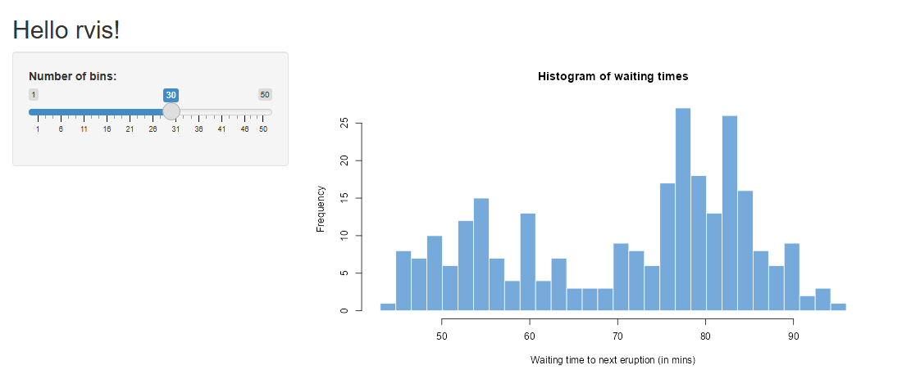

# Dashboards: getting started

rvis builds complete [shiny](https://shiny.posit.co/) apps from a
configuration: a YAML or JSON file, or an R list. The configuration
lists the **items** of the dashboard (inputs, outputs and containers),
how they are laid out, and their **services**: the R code that makes the
content of each output or runs when an input changes. You do not write
the user interface and server functions of the app yourself.

This guide explains the main ideas. The other dashboard guides go
further:

| Guide | Content |
|:---|:---|
| [Layouts](https://genpack.github.io/rvis/articles/dashboard-layouts.md) | Pages, rows and columns, sidebars, tabs, navigation bars, shinydashboard pages and clothes |
| [Item reference](https://genpack.github.io/rvis/articles/dashboard-reference.md) | Every item type and its settings, the server environment, reactive values, dynamic interfaces, tooltips, modals, guided tours, login and synced tables |
| [Gallery](https://genpack.github.io/rvis/articles/dashboard-gallery.md) | Apps of the Shiny gallery rebuilt from YAML, and two large showcase dashboards |
| [Shiny packages](https://genpack.github.io/rvis/articles/dashboard-extensions.md) | Packages of the Shiny ecosystem that rvis supports, and the ones it could support |

## A first dashboard

This YAML file describes a page with a slider and a histogram:

``` yaml
# The smallest useful dashboard: one input, one output and a page layout.
name: Hello rvis
# the item that makes the page
layout: page

items:
  # a container: a fluid page with a title, a side panel and a main panel
  page:
    type: sidebarLayout
    title: Hello rvis!
    layout.side: [bins]
    layout.main: [hist]

  # an input: its value is input$bins in the services
  bins:
    type: sliderInput
    title: "Number of bins:"
    min: 1
    max: 50
    value: 30

  # an output: its service is R code returning the content (here a plot) and is run again when input$bins changes
  hist:
    type: plotOutput
    service: |
      x <- faithful$waiting
      bins <- seq(min(x), max(x), length.out = input$bins + 1)
      hist(x, breaks = bins, col = "#75AADB", border = "white",
           xlab = "Waiting time to next eruption (in mins)",
           main = "Histogram of waiting times")
```

It comes with rvis as an example.
[`rvisDashboard()`](https://genpack.github.io/rvis/reference/rvisDashboard.md)
reads it and returns a `DASHBOARD` object, which runs as a shiny app:

``` r

library(rvis)
dash <- rvisDashboard(rvisDashboardExample("hello"))
dash$run()                     # or: runDashboard(rvisDashboardExample("hello"))
```



`dash$app()` returns the shiny app object (for example to deploy it in
an `app.R` file), `dash$dashboard.ui()` and `dash$dashboard.server()`
return the user interface and the server function.

## The parts of a configuration

| Field | Meaning |
|:---|:---|
| `name` | Name of the dashboard. |
| `layout` | The item (or items) making the page, usually one page container like `fluidPage`, `sidebarLayout`, `navbarPage` or `dashboardPage`. |
| `items` | The items, by name. The name of an item is its shiny id: input `bins` is `input$bins` in the services. |
| `prescript` | R code run at the start of each session, for example to define reactive expressions and functions used by the services. |
| `objects` | Objects copied into `session$userData` of each session. |
| `values` | Initial values of the reactive list `sync` of each session. |
| `observers` | R code run in [`observe()`](https://rdrr.io/pkg/shiny/man/observe.html) in each session. |
| `settings`, `messages`, `loginTable` | Settings, messages and users of dashboards with a login item. |

Every item has a `type`. There are three kinds of items:

- **inputs** (`textInput`, `selectInput`, `sliderInput`, `actionButton`,
  …) take their label from `title`. Their optional `service` is run when
  the input changes.
- **outputs** (`textOutput`, `plotOutput`, `tableOutput`,
  `dataTableOutput`, `highcharterOutput`, …) show the result of their
  `service`, which is run again whenever an input or reactive value it
  uses changes. A `static` item shows fixed content (`html`, or any
  shiny tag as `object`).
- **containers** (`fluidPage`, `sidebarLayout`, `tabsetPanel`, `box`,
  `bsModal`, …) hold other items, given by name in their `layout`.

Any item can also have a **cloth**: a box, value box, column, well panel
or tab panel wrapped around it without defining a container item, and a
**tooltip**, **popover** or **tutor lesson** (guided tour).

## Services

A service is R code, written as text in the configuration. It is
evaluated in the server function of the session, where these objects are
available:

| Object | Meaning |
|:---|:---|
| `input`, `output`, `session` | The usual shiny objects. |
| `sync` | Reactive list of the session, with the initial `values` of the configuration (and the synced tables). |
| `report` | Reactive list reporting the state of synced tables (edits, filters, selections). |
| `session$userData` | The `objects` of the configuration, copied for the session. |
| `items`, `settings`, … | The fields of the dashboard. |
| `hideItems()`, `showItems()`, `enableItems()`, `disableItems()`, `updateItem4Session()` | Methods of the dashboard (see the [reference](https://genpack.github.io/rvis/articles/dashboard-reference.html#methods)). |

Multi-line services use the YAML block scalar `|`:

``` yaml
  plot:
    type: plotOutput
    service: |
      d <- mtcars[mtcars$cyl == input$cyl, ]
      plot(d$wt, d$mpg)
```

Reactive expressions used by several services are defined in the
`prescript`:

``` yaml
prescript: |
  selected <- reactive(mtcars[mtcars$cyl == input$cyl, ])
items:
  plot:  {type: plotOutput, service: plot(selected()$wt, selected()$mpg)}
  table: {type: tableOutput, service: head(selected())}
```

## YAML, JSON or R lists

**R values in YAML.** Values tagged `!expr` are R expressions, evaluated
when the file is read:

``` yaml
  variable:
    type: selectInput
    title: Variable
    choices: !expr names(mtcars)
```

**Named choices.** A YAML mapping gives choices with labels (label:
value):

``` yaml
    choices: {Normal: norm, Uniform: unif}
```

**Text and logical values.** rvis reads YAML with YAML 1.2 rules: only
`true` and `false` are logical values. Words like `yes`, `no`, `y` or
`n` stay text, so items can be named `n` or `y`. Quote values that
contain a colon followed by a space (`title: "Number of bins:"`), and do
not put R code containing commas in a flow mapping like
`{type: actionButton, service: f(a, b)}`: use the block form instead.

**JSON.** The same configuration can be a JSON file (without `!expr`
values). In JSON, a list of one item name (`["a"]`) is read as the name
itself: write a column of one item as `{"items": "a"}` in layouts.

**R lists.** The configuration can also be an R list. Fields given to
[`rvisDashboard()`](https://genpack.github.io/rvis/reference/rvisDashboard.md)
are added to the configuration, which is useful to pass R objects:

``` r

dash <- rvisDashboard(list(
  layout = "page",
  items  = list(
    page = list(type = "fluidPage", title = "Hello", layout = list("n", "hist")),
    n    = list(type = "sliderInput", title = "Observations", min = 10, max = 500, value = 100),
    hist = list(type = "plotOutput", service = "hist(rnorm(input$n))"))))

# a YAML configuration with objects from the R session:
dash <- rvisDashboard("my-dashboard.yml", objects = list(sales = my_sales_table))
```

The original R interface still works:
`new("DASHBOARD", items = items, king.layout = list("page"))`.

## The examples

rvis comes with 40 example dashboards:

``` r

ex <- rvisDashboardExample()
ex[, c("name", "group", "title")]
#>                 name    group                                           title
#> 1             charts   basics                                     rvis charts
#> 2       click-events   basics                                    Click events
#> 3            clothes   basics                                         Clothes
#> 4            dynamic   basics                               Dynamic interface
#> 5      generic-types   basics                              Generic item types
#> 6              hello   basics                                      Hello rvis
#> 7             inputs   basics                                     Input items
#> 8        layout-grid   basics                                     Layout grid
#> 9              login   basics                                           Login
#> 10   modals-tooltips   basics                             Modals and tooltips
#> 11            navbar   basics                                     Navbar page
#> 12           outputs   basics                                    Output items
#> 13          reactive   basics                                 Reactive values
#> 14    shinydashboard   basics                                     Earthquakes
#> 15      shinywidgets   basics                                    shinyWidgets
#> 16      synced-table   basics                                    Synced table
#> 17              tabs   basics                                            Tabs
#> 18             tutor   basics                                     Guided tour
#> 19   basic-datatable  gallery                                 Basic DataTable
#> 20 conditional-panel  gallery                              Conditional panels
#> 21             dates  gallery                           Dates and date ranges
#> 22          diamonds  gallery                               Diamonds Explorer
#> 23          download  gallery                                Downloading Data
#> 24        dynamic-ui  gallery Dynamically generated user interface components
#> 25          faithful  gallery                                        Faithful
#> 26           isolate  gallery                                 isolate example
#> 27            kmeans  gallery                         Iris k-means clustering
#> 28      modal-dialog  gallery                                    Modal dialog
#> 29      more-widgets  gallery                                    More Widgets
#> 30    navbar-example  gallery                                         Navbar!
#> 31  plot-interaction  gallery                        Plot interaction - basic
#> 32          progress  gallery                            Progress bar example
#> 33        reactivity  gallery                                      Reactivity
#> 34       shinythemes  gallery                                     shinythemes
#> 35           sliders  gallery                                         Sliders
#> 36           tabsets  gallery                                         Tabsets
#> 37        telephones  gallery                            Telephones by region
#> 38             timer  gallery                                           Timer
#> 39     data-explorer showcase                                   Data explorer
#> 40         us-states showcase                              US states explorer
```

- **basics**: one feature each, used in the
  [layouts](https://genpack.github.io/rvis/articles/dashboard-layouts.md)
  and
  [reference](https://genpack.github.io/rvis/articles/dashboard-reference.md)
  guides;
- **gallery**: apps of the [Shiny
  gallery](https://shiny.posit.co/r/gallery/) rebuilt from YAML (see the
  [gallery](https://genpack.github.io/rvis/articles/dashboard-gallery.md));
- **showcase**: two large dashboards combining most features.

Run any of them with `runDashboard(rvisDashboardExample("<name>"))`, and
copy their files to start your own:

``` r

file.copy(rvisDashboardExample("us-states"), "my-dashboard.yml")
```
